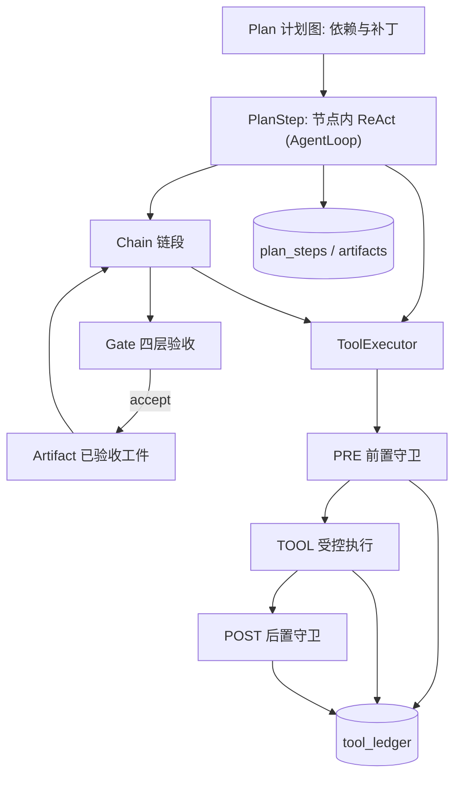
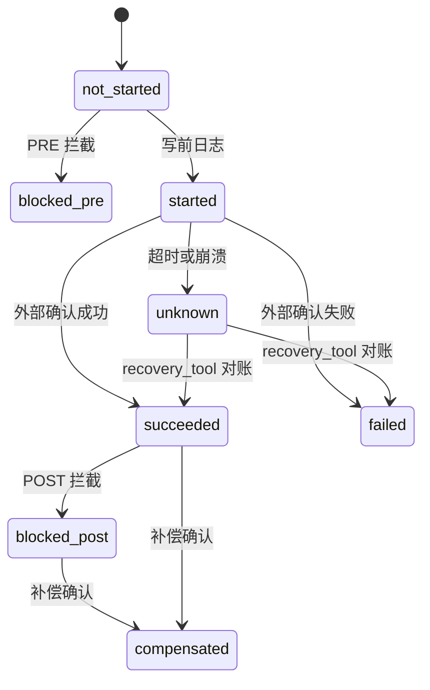

# 10.08 工具集生产化方案（V1-V5）

> 状态：设计方案，尚未实现。判断当前行为以 `agent/main.py:build_gateway` 的装配和 [tool&skill&plugin](../recognitionDocs/tool&skill&plugin.md) 为准。

目标：基于现有的 `Tool / ToolRegistry / AgentLoop / SQLite` 存储，按“最简工具集、工具调度、规划执行、提示链、护栏三明治”五层（对应 V1-V5），把工具从“能调用”升级为“边界可控、副作用唯一、状态可恢复、结果可验收”的生产级工具体系。

| 场景 | 对应能力 |
| --- | --- |
| V1 越界改字段 | 最简工具集 |
| V2 跳读与双付 | 工具调度 |
| V3 中途超时后整批重跑 | 规划执行 |
| V4 污染工件向后传递 | 提示链 |
| V5 高风险输入输出 | 护栏三明治 |

## 0. 现状与差距

- [agent/tools/base.py](../../agent/tools/base.py) 的 `Tool` 只有 `name / description / parameters`；[agent/tools/registry.py](../../agent/tools/registry.py) 的 `dispatch` 只兜底异常，`get_schemas()` 把全部工具暴露给所有 agent。
- [agent/core/agent_loop.py](../../agent/core/agent_loop.py) 的 `_execute_tool` 按工具名写死注入 `_scope / _skills / _source_message_id`，并且按顺序执行；`ToolCall` 只存在内存里的 `session.tool_calls` 中，等 turn 提交时才写入 `tool_calls` 表。进程如果崩溃，“这次调用做没做过”的信息就丢了。
- 现成可复用的模式：
  - `memory_edit` 的 `expected_revision / expected_hash`：版本前置条件，类似 git。
  - `jobs` 表的 `dedupe_key + lease + revision CAS`：幂等和租约。
  - `SkillSelection` 的单 turn 冻结快照：适合用来冻结工具集和工具契约。
  - `EnvironmentSnapshotter` 已经采集 `tool_schemas`：可以作为契约漂移的比对基线。
  - [memory_claim_evidence.py](../../agent/core/memory/memory_claim_evidence.py) 的名称和数字锚点检查：可用于“事实与来源”闸门。
- `005_memory_cleanup.sql` 已经删除 `workspace_items` 等表。计划层要重建，只保留步骤、依赖和账本这几项必要字段。

## 1. 工具生产的四个问题

1. **能调什么、能改什么**（边界问题）：对应 V1 越界改字段，用最简工具集解决。
2. **这件事做没做过**（副作用唯一性）：对应 V2 双付和 V3 超时后整批重跑，用工具调度、幂等账本和规划执行解决。
3. **基于哪个版本做**（状态新鲜度）：对应 V2 跳读和 V3 “计划时冻结、执行时重新核验”。
4. **结果能不能往下传或对外发布**（可信度）：对应 V4 污染工件向后传递和 V5 高风险输入输出，用提示链闸门和护栏三明治解决。



## 2. 工具契约字段与最简工具集（V1）

### 2.1 基础字段

只保留基础字段，作为一个冻结的载体挂在 `Tool.policy` 上：

```python
class ToolPolicy(BaseModel):
    model_config = ConfigDict(frozen=True)
    when_to_use: str
    when_not_to_use: str
    source: Literal["builtin", "skill", "mcp"] = "builtin"
    effect: Literal["read", "write", "external"] = "read"
    risk: Literal["low", "medium", "high", "critical"] = "low"
    permission: Literal["any", "user", "owner", "admin"] = "any"
    idempotency: Literal["read_only", "idempotent", "keyed", "non_idempotent"] = "read_only"
    key_fields: tuple[str, ...] = ()       # 业务幂等键取自哪些有效参数
    precondition_field: str | None = None  # expected_revision / expected_hash
    max_calls_per_turn: int = 8
    timeout_s: float = 30
    requires_approval: bool = False
    recovery_tool: str | None = None       # 查询外部真实状态，用于 UNKNOWN 对账
    compensation_tool: str | None = None   # 补偿 / 撤销
    contract_version: str = "1"
```

字段分组：

- 身份：`name`、`description`、`when_to_use`、`when_not_to_use`、`contract_version`。
- 类型：`source`（含 MCP）、`effect`、`risk`、`permission`。
- 运行限制：`max_calls_per_turn`、`timeout_s`。
- 副作用：`idempotency`、`key_fields`、`precondition_field`、`requires_approval`。
- 恢复：`recovery_tool`、`compensation_tool`。

`parameters` 一律使用严格 schema（`additionalProperties: false`）。`to_openai_schema()` 把 `when_to_use` 和 `when_not_to_use` 拼进 description 发给模型。

### 2.2 按 agent 或任务配置工具集

`Toolset` 放进 `AssemblyPolicy.toolset`，遵守“`run_turn` 只传 `AssemblyPolicy`”的约定：

```python
class Toolset(BaseModel):
    name: str
    tools: tuple[str, ...]
    max_calls: dict[str, int] = {}  # 只能比 policy 更严，不能放宽
    max_risk: Literal["low", "medium", "high", "critical"] = "medium"
```

- `get_schemas(toolset)` 只暴露工具集内的工具。
- `dispatch` 遇到工具集之外的名字直接返回 `tool_not_in_toolset`。和 `SkillSelection` 一样，模型猜中名字也调不了。

### 2.3 启动时的运行检验

由 `ToolRegistry.validate(toolset)` 执行，不通过就立即报错退出：

- 工具已注册，policy 完整，`when_to_use` 和 `when_not_to_use` 都不为空。
- schema 是严格的，`required` 字段齐全。
- `effect` 不是 `read` 时，`idempotency` 不能是 `read_only`；`keyed` 工具必须声明 `key_fields`。
- `risk` 为 `high` 及以上时，必须声明 `recovery_tool`，并且它在同一个工具集里；`external + non_idempotent` 不允许进入自动执行。
- 风险高于 `toolset.max_risk` 的工具不能进入该工具集；MCP 工具在人工定级前一律视为 `high`。
- 技能的 `required_tools` 必须是工具集的子集：`_freeze_skills` 改为传 `toolset.tools`。

### 2.4 现有工具定级

- `calculator`、`use_skill`、`memory_search`、`memory_read`：read，low，read_only。
- `skill_manage`：write，medium，keyed（`name`），复用已有的 `revision_conflict`。
- `memory_edit`：write，medium，`precondition_field=expected_revision/expected_hash`，`manual_restore` 作为恢复手段；“事实卡只能改 4 个字段”的规则迁移到该工具的 PRE 守卫。
- `bash`、`file_write`：暂不注册；如果启用，定为 high，并且必须带内容 hash 前置条件。

## 3. 工具账本：不再把状态只放在内存里

新增迁移 `006_tool_ledger.sql`：

```sql
CREATE TABLE tool_ledger (
 entry_id TEXT PRIMARY KEY, idempotency_key TEXT NOT NULL UNIQUE,
 tool_name TEXT NOT NULL, contract_version TEXT NOT NULL,
 session_id TEXT, turn_id TEXT, plan_id TEXT, step_id TEXT, tool_call_id TEXT,
 status TEXT NOT NULL CHECK(status IN ('not_started','started','succeeded','failed',
   'unknown','blocked_pre','blocked_post','compensated')),
 attempt INTEGER NOT NULL DEFAULT 0, revision INTEGER NOT NULL DEFAULT 1,
 resource_ref TEXT, resource_version TEXT,
 requested_args_json TEXT NOT NULL, effective_args_json TEXT,
 raw_output_json TEXT, publishable_output_json TEXT,
 pre_decision_json TEXT, post_decision_json TEXT, external_ref TEXT,
 lease_owner TEXT, lease_expires_at INTEGER,
 created_at INTEGER NOT NULL, updated_at INTEGER NOT NULL
);
CREATE INDEX idx_ledger_resource ON tool_ledger(resource_ref, updated_at);
CREATE INDEX idx_ledger_step ON tool_ledger(plan_id, step_id);
```

状态含义：

| 状态 | 含义 |
| --- | --- |
| `not_started` | 尚未发起 |
| `started` | 已经发起 |
| `succeeded` | 外部确认成功 |
| `failed` | 外部确认失败 |
| `unknown` | 结果仍不确定 |
| `blocked_pre` | 工具没有运行 |
| `blocked_post` | 原始结果不再发布，外部影响可能已经发生 |
| `compensated` | 外部系统已经确认补偿成功 |



规则：

- **写前日志**：调用外部系统之前，先用 CAS 把状态写成 `started`，同时落盘 `effective_args`；拿到结果再写终态。所有状态转移都带 `WHERE revision=?`。
- **幂等键**：`sha256(tool_name, contract 主版本, key_fields 对应的有效参数, 业务 scope)`。
  - 不要把 `turn_id` 放进去，否则跨 turn 重试会生成新键。
  - `non_idempotent` 工具的键里包含 `tool_call_id`，等于不去重，因此不允许自动重试。
- **证据分离**：必须同时保存请求参数和有效参数、原始输出和可发布输出。参数被改写、结果被遮蔽或调用被拦截时，证据都还在。
- **读工具也记账**：只记 `resource_ref / resource_version`，不存大段输出，用来支持跳读检查。
- **与会话事实的关系**：`ToolCall` 继续作为会话事实，通过 `metadata.ledger_entry_id` 关联账本行；`status` 新增 `unknown / blocked`。`ToolCallResult` 新增 `status` 和 `ledger_entry_id`。

## 4. 工具执行器与调度（V2）

新增 `agent/tools/executor.py` 中的 `ToolExecutor`，替换 `AgentLoop._execute_tool` 和 `dispatch` 的函数体。新增 `ToolContext`（scope、source_message_id、skills、turn_id、plan/step、身份），由执行器注入，取代按工具名写死的注入。

主链：`ToolCallRequest -> ToolExecutor -> ToolCallResult -> ToolCall`。

### 4.1 执行顺序

1. 准入：检查是否属于工具集，调用次数按账本计数，不按内存计数。
2. 语法和结构：按严格 schema 校验参数。
3. 计算幂等键并查账：
   - `succeeded`：直接回放 `publishable_output`，不再执行。
   - `started / unknown`：进入对账。
   - `blocked_*`：按记录的原因直接返回。
4. 运行 PRE 守卫，生成有效参数。
5. CAS 写入 `started`。
6. 带超时执行 TOOL：
   - 有副作用的工具超时或异常，记为 `unknown`，不能记为 `failed`。
   - 只读工具超时，记为 `failed`，可以安全重试。
7. 运行 POST 守卫，得到可发布输出。
8. 返回结果。

### 4.2 并发与幂等

- 同一次模型响应里有多个工具调用时：`read_only / idempotent` 可以并行；`write / external` 按 `resource_ref` 串行，用进程内锁，跨进程再由账本的 UNIQUE 约束兜底。
- 同一幂等键的并发调用只有一个能 CAS 成 `started`，其余调用等待终态，或者直接返回 `in_flight`。

### 4.3 跳读：状态版本约束

参考 git “基于的版本已变就拒绝 push”：写工具的 PRE 要求本 turn 或本 step 的账本里有同一 `resource_ref` 的读记录，并且其 `resource_version` 等于前置条件里的版本。不满足就记为 `blocked_pre: stale_precondition`，提示模型重新读取。

## 5. 护栏三明治（V5）

```
输入参数 -> 前置守卫（PRE） -> 工具执行（TOOL） -> 后置守卫（POST） -> 可发布结果
```

PRE 和 POST 用钩子实现，按顺序执行，前面任一失败就短路：

```python
class ToolGuard(Protocol):
    def pre(self, request: ToolCallRequest, context: ToolContext) -> GateDecision: ...
    def post(self, request: ToolCallRequest, raw: ToolCallResult,
             context: ToolContext) -> GateDecision: ...
```

- **PRE**：检查权限（context 里的身份与 `policy.permission`）、参数业务条件、版本前置条件、契约漂移和审批，并产出 `effective_args`，允许裁剪、规范化和补默认值。只有 PRE 全部通过，执行器才真正调用工具。
- **TOOL**：受控执行器负责调用，带超时，结果写入账本。
- **POST**：检查输出 schema，遮蔽敏感信息，核对外部回执、事实与来源，产出可发布输出。不通过时记为 `blocked_post`：原始结果保留，但不发布；外部影响可能已经发生，需要触发补偿判断。
- **审批**：遇到 `requires_approval` 时，先记为 `blocked_pre(approval_required)`。审批通过后不直接放行，而是开一个新 attempt，重新跑完整的 PRE，因为等待审批期间状态可能已经变了。
- **契约漂移**：turn 或 plan 开始时冻结 `{tool_name: contract_hash}`，hash 覆盖 parameters、output_schema、policy 和 contract_version，可复用 `EnvironmentSnapshotter`。执行时 high 及以上的工具 hash 不一致，就记为 `blocked_pre: contract_drift`。
- **组合工具**：单个工具的钩子只保证这一次调用正确。像“先查后付”这类组合动作的整体不变量，交给 PlanStep 或链段的闸门检查。

## 6. 规划执行（V3）

新增 `agent/core/plan/`，包含 `Plan`、`PlanStep`、`PlanPatch`、`PlanValidator` 和 `PlanRunner`。迁移文件为 `007_plan_ledger.sql`，包含 `plans`、`plan_steps`、`plan_patches` 三张表，租约机制复用 `jobs` 的写法。

```python
class PlanStep(BaseModel):
    step_id: str
    goal: str
    depends_on: tuple[str, ...]
    toolset: str                  # 节点内 ReAct 可用的工具
    target_ref: str | None        # 计划时冻结：给哪张工资单发薪
    target_version: str | None
    status: Literal["todo", "ready", "doing", "done", "failed",
                    "unknown", "blocked", "skipped"]
    attempt: int = 0
    chain: tuple[str, ...] = ()   # 节点内的提示链段，可以为空
    max_iterations: int = 6
```

### 6.1 调度与 ReAct

- 一个步骤的状态是 `todo`，并且所有依赖都是 `done`，就是可运行的。拿到租约后，用该步骤的工具集调用 `AgentLoop.run_turn`。
- 规划执行和 ReAct 不冲突：宏观依赖由计划图保持稳定；节点内部是 ReAct，可以观察环境、调用工具、做有限调整。
- 环境变化超出节点边界时（目标对象变了、依赖失效），步骤返回 `needs_patch`，由规划器提交 `PlanPatch`。

### 6.2 计划可能比执行更早

- 计划时：冻结 `target_ref + target_version`，也就是“给哪张工资单发薪”。
- 执行时：由 PRE 重新核验“这张工资单现在能不能发”。不一致就把步骤置为 `blocked`，再走补丁流程。

### 6.3 崩溃恢复

场景：执行器向银行发出付款请求，银行已经入账，本地还没写下 DONE，进程崩溃；重启后只看到该步骤仍是 `doing`。

重启后对每个仍是 `doing` 的步骤，按 `step_id` 查账本：

- 账本是 `succeeded`：补写步骤为 `done`。
- 账本是 `started / unknown`：用 `recovery_tool(idempotency_key / external_ref)` 对账。
  - 外部已入账：记为 `done`。
  - 外部确认没有这笔：记为 `failed`，之后用同一个幂等键重试。
  - 无法判定：保持 `unknown`，阻塞依赖它的子图，并升级给人工。
- 账本里没有记录：可以安全地重跑这个步骤。
- 任何情况下都不能把 `doing` 盲目重置成 `todo`。

幂等账就是一张“这件业务动作到底做没做过”的记录表，用来防止 Agent 因重试、超时或恢复任务而重复产生副作用。

### 6.4 计划补丁校验器

`PlanValidator` 的固定规则：

1. 补丁只能替换受影响范围（失败子图）内已有的步骤。
2. `done` 步骤不得被覆盖。
3. 原步骤指向范围外节点的依赖不得删除。
4. 新增步骤必须接回失败子图，数量不超过 cap。
5. 补丁的 `base_revision` 必须等于当前计划版本（CAS）；`unknown` 步骤要先完成对账，补丁才能动它。

### 6.5 E0007 / E0012 例子

E0007 已经付款，s7 是 `done`；E0012 中途超时，对应步骤是 `unknown`。一份外部恢复说明要求整批从头再来，对应的补丁会被规则 2 拒绝。即使补丁绕过了校验，工具层的幂等账本也会拦住 E0007 的第二次付款。这是两道独立的防线。

超时本身和 Agent 没关系，Agent 参与的是“超时以后怎么办”的决策，所以这个决策必须受计划边界和账本约束。

## 7. 提示链：链条、工件、闸门（V4）

上一步讲的东西，下一步凭什么相信？格式合法不代表内容正确，所以上一段的结果交给下一段之前一定要经过验收。

### 7.1 分工

- **规划执行**：哪一个计划步骤（PlanStep）现在可以运行，失败后允许修改哪一片子图。
- **提示链**：一个计划步骤内部有哪些链段，每一段交出的工件能否进入下一段。
- 步骤是调度单位，链条是步骤内部的段序。长任务既要有步骤集合与依赖，也要有中间产物、闸门和校验。

### 7.2 工件

新增 `artifacts` 表，字段包括 `artifact_id, plan_id, step_id, segment, revision, content_hash, payload_json, source_refs_json, status(pending/accepted/rejected), gate_decision_json`。

- 下一段只能按 `artifact_id + hash` 读取已经 accepted 的工件。
- 被拒绝的工件保留，用于审计。

### 7.3 结构化闸门判定

闸门和守卫共用一个结构化判定类型，不只返回 True 或 False，为恢复策略保留更多信息：

```python
class GateDecision(BaseModel):
    verdict: Literal["accept", "repair", "retry", "block", "escalate"]
    layer: Literal["syntax", "structure", "semantics", "facts", "pre", "post"]
    reasons: tuple[str, ...]             # code:field_path
    detail: str = ""
    evidence_refs: tuple[str, ...] = ()  # ledger:/artifact: 引用
    effective_value: dict | None = None  # PRE 改写后的参数 / POST 遮蔽后的输出
    retryable: bool = False
```

### 7.4 四层检查

从低成本到高成本依次执行，任一层失败就短路。以工资单为例：

1. **语法**：能解析，数值格式合法。
2. **结构**：schema 和必填字段正确，输出行数等于输入员工数，`employee_id` 不重复。
3. **语义**：实发等于应发减扣款，金额大于 0，所属期间一致。
4. **事实与来源**：每个金额和账号都能追溯到账本里的 `raw_output`，或上游已验收的工件。

### 7.5 判定驱动恢复

- `repair`：做确定性修复，然后重新过闸门。
- `retry`：只重跑本段，并把失败原因回注给模型，重试次数有上限。
- `block`：步骤记为 `failed`，转入补丁流程。
- `escalate`：交给人工。

### 7.6 适合拆成提示链的任务

- 任务有清晰阶段，每一段都能定义可检查的输出。
- 核算、生成、校对和合规需要不同的模型、规则或工具。
- 中间结果需要留档、复核，或者被其他系统消费。
- 错误越过交接点以后，代价会明显放大。

## 8. 场景回归（V1-V5 作为验收用例）

新增 `tests/tools/` 和 `tests/core/plan/`，用一个假银行工具 `fake_pay`（keyed、external、high）和 `payment_query`（它的 recovery_tool）来跑：

- **V1**：工具集里没有 `memory_edit` 时调用它，返回 `tool_not_in_toolset`；`memory_edit` 带 `kind` 字段，记为 `blocked_pre`；启动校验能识别缺少 `recovery_tool` 的高风险工具。
- **V2**：同一次响应里有两个同键的付款调用，只发生一次外部调用；写之前没读，或读到的版本已过期，返回 `stale_precondition`。
- **V3**：E0007 是 `done`、E0012 超时变成 `unknown`，要求整批重置的补丁被拒绝；重启后 `doing` 步骤走对账，不会重复付款。
- **V4**：核算段合计不平，在语义层被 block，下一段不执行，工件以 rejected 状态留档。
- **V5**：POST 遮蔽敏感字段，`raw_output` 和 `publishable_output` 分开保存；契约 hash 变化时返回 `contract_drift`；审批后状态变了，重新跑 PRE 时被拦截。

## 9. 落地顺序

1. V1：`base.py` 增加 `ToolPolicy`，`AssemblyPolicy` 增加 `Toolset`，实现 `ToolRegistry.validate / get_schemas(toolset)`，给现有工具定级。
2. 账本：新增 `006_tool_ledger.sql` 与 `SqliteToolLedgerStore`（写前日志、CAS 状态转移、幂等键查询、resource 版本查询），挂到 `RuntimeStorage`。
3. V2 / V5：实现 `ToolExecutor + ToolContext + ToolGuard`（PRE/POST、跳读、契约漂移、审批后重跑 PRE），替换 `AgentLoop._execute_tool` 中按工具名写死的注入。
4. V3：实现 `agent/core/plan/`（`Plan / PlanStep / PlanPatch / PlanValidator / PlanRunner`）、`007_plan_ledger.sql` 和重启对账恢复。
5. V4：实现 `artifacts` 表与 `GateDecision` 四层闸门，链段只消费已验收的工件。
6. 补齐 V1-V5 场景回归测试，并更新 [tool&skill&plugin](../recognitionDocs/tool&skill&plugin.md)。

## 10. 不做的事

- 不引入通用的 `Result[T]`，不新增 Payload / DTO 一类的类型；`ToolCallResult`、`ToolCall`、`TurnResult` 原样复用，只扩字段。
- 这一轮不实现 MCP 加载器，只预留 `source="mcp"` 和契约漂移检查。
- 不做分布式锁：单机下 SQLite 的 UNIQUE 约束和 CAS 已经足够。
