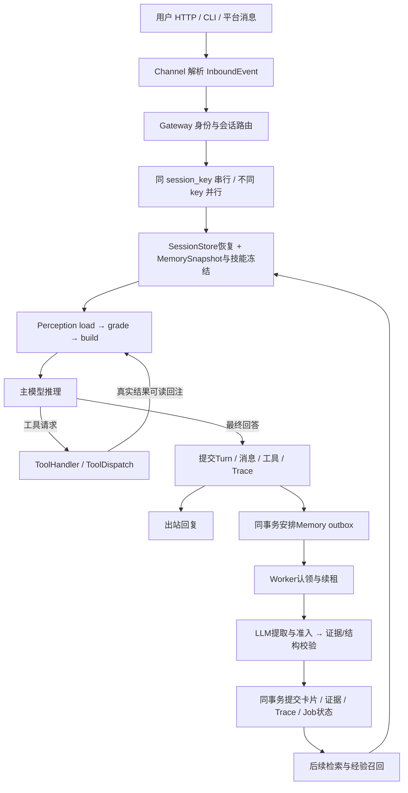

# 核心模块数据流与架构面试说明

历史消融结果及复现脚本已清理；本文仅保留架构说明。

## 一、完整数据流

1. **入口与装配。** `agent/main.py`启动HTTP/CLI，`agent/runtime.py`装配ModelRegistry、工具/技能、SQLite、Memory、可选Action、Perception、Loop和Gateway。Loop不知道渠道协议，ModelRegistry隔离provider差异。
2. **身份与并发。** Channel生成SessionSource；Gateway生成session_key负责本会话排队，MemoryScope负责跨会话归属。DM按渠道+用户共享长期记忆；群聊使用群scope，不能生成个人用户卡。Scope由运行时传给工具，不接受模型自己指定别人的scope。
3. **每轮快照。** Gateway恢复Session，冻结Markdown规则/手册及少量关键词经验；Loop冻结技能、工具集合和执行上下文。手册不等于所有卡片常驻，身份/偏好/项目卡仍按需搜索。
4. **Perception。** load把系统、技能、记忆和历史统一为ContextItem；grade按P0/P1/P2/P3与预算决定保留、Anchor替代、延期读回或丢弃；build生成实际messages。P0是系统/技能/手册等固定规则；P1保护失败信息、当前重要操作及经验；P2是历史对话、近期原文和Anchor；P3是可按引用恢复的资料。分级依据具体item，不能只按role机械套级别。
5. **ReAct循环。** 主模型返回文本或工具请求。工具请求写assistant协议消息，再执行并写tool消息，重新构建上下文。schema、消息和输出预留一起受预算约束。主模型瞬时失败/空答有限重试，不把空答当完成。
6. **工具执行。** 基本路径检查工具与参数；Action路径额外有工具集、PRE、幂等账本、执行/POST、发布和恢复。执行成功、结果可发布、对话提交成功是不同状态；超时导致外部结果不明时不能盲目重复写。
7. **事实提交。** Loop返回TurnResult后，Gateway/SessionStore原子提交本轮原文、工具事实、状态、Trace和记忆调度。提交成功后才finish pending Trace、通知后台。SSE是观测，不等于数据库事务已成功。
8. **异步记忆。** 调度器按scope累计在1、3、6、10轮及之后每5轮形成批次，reset/停止时flush。Worker领取持久Job、续租，模型调用在事务外；校验后的提交把卡片、证据、Trace和completed状态同事务写入。重试历史继续保存。
9. **冲突与生命周期。** 事实使用kind/subject/attribute槽位；重复合证据，更正替代旧卡，不确定冲突保留原值并记录。经验不共用事实槽。卡片revision用于CAS，valid_from/until用于时效，deleted用于遗忘并防旧证据复活。
10. **下一次回答。** Retriever先按scope/status/有效期筛选；目前是关键词与中文二元组匹配，未实现语义向量RAG。搜索给引用/片段，read分页原文或卡片，edit仅在用户明确更正/删除时执行。读回统计只记实际曝光且被读回的来源。

## 二、三条主线必须分开理解

| 主线 | 保存什么 | 生命周期 | 不等于什么 |
|---|---|---|---|
| 原始事实 | 消息、工具参数/结果/错误、执行时间 | 审计与恢复的基础 | 不能被模型摘要替换 |
| 工作上下文Perception | 有预算的本轮投影、Anchor、读回引用 | 每次模型请求重建 | 不是永久用户记忆 |
| 长期Memory | 有证据的身份、偏好、阶段事实、经验 | 跨会话、可更正/删除/过期 | 不是每句话都存卡或全文RAG |

还有三个ID概念：session_key是路由槽；session_id是实际会话；scope_key是跨会话归属。工具也有provider调用ID和持久事实ID。混用这些ID会导致协议错配、跨用户泄漏或查不到原文。

## 三、面试官可能怎样拆解

| 追问 | 你应解释的设计与取舍 |
|---|---|
| 为什么不把全部历史塞给LLM？ | 输入预算、重复资料、噪声、迭代成本。给38.73%整轮主输入实测，随后主动说明Anchor成本抵消冷启动收益。 |
| Perception和Memory有什么不同？ | 前者控制本次发送什么，后者判断以后值得记什么；都依赖原始事实库，但生命周期不同。 |
| 为什么不直接截断最后N轮？ | 最早的决定可能仍有效，中段有偏好，末尾有更正。分级保护、来源绑定的Anchor与原文读回支持恢复；仍存在模型漏提取风险。 |
| Anchor错误怎么处理？ | 版本、覆盖范围、来源与预算校验，失败降级保护原文或明确构建失败；来源有效不代表语义必然正确。 |
| LLM判断值得记，可信吗？ | LLM只提案；来源ID、逐字quote、名称/数字、敏感内容、类别、成败和scope由代码检查，准入再审。多次模型一致不是事实证明。 |
| 如何避免第三方身份变成用户资料？ | 明确主体、排除虚构/第三方、禁止由归属排除反推负向偏好；用负例误建率验证。 |
| Memory“召回率”到底指什么？ | 分清提取Recall、卡片Precision、检索Recall@K、最终回答正确率。引用9/9与样本范围，别把答案正确当卡片已保存。 |
| 新旧事实冲突怎么办？ | 同槽位与证据时序/权限判断、CAS修订、superseded与conflicts；模型confidence不能代替用户授权。有限文本判别规则仍需更多开放表达测试。 |
| 为什么用outbox？ | 业务事实提交和安排提炼在同事务，避免写完事实却丢通知；worker可重启续租。是至少一次消费配合幂等提交，不保证外部副作用严格exactly-once。 |
| 两个人同时操作怎么办？ | Gateway同key串行、不同key并行；不可把每轮context放到共享Loop字段。SQLite短连接、WAL、短写事务和revision防冲突；进程内队列/锁不能代替多进程协调。 |
| SQLite为什么够用、何时不够？ | 单机方便、事务与调试简单；写入仍受串行约束，搜索instr扫描不适合大规模。后续需负载数据决定FTS/向量索引、外部队列及服务型数据库。 |
| 保存查询列又保存JSON不是冗余吗？ | 查询列负责索引和关联，JSON负责完整领域恢复；Store统一写入与回归约束，承认双写一致性是维护成本。 |
| 失败工具是不是可以自动重试？ | 读可重试与写副作用不同。Ledger记录started/unknown并核对外部状态，不能把网络超时当作没有发生。 |
| Scope是否就是认证？ | 不是。HTTP已有Origin白名单/可配置Bearer、非本机必须token；这是操作者接口，允许调用者指定身份，不是完整公网多租户IAM。 |
| 为什么没有直接用向量库？ | 当前可解释关键词检索+LLM改写查询足够做原型；没有证明开放域同义词和大语料召回。需要查询标注后比较关键词、FTS与向量检索。 |
| 如何证明优化效果？ | 冻结题目/截止、同模型四组、实际usage含重试、单列辅助与读回成本、原文不变/外键审计，保留失败，明确小样本和同模型评分偏差。 |

