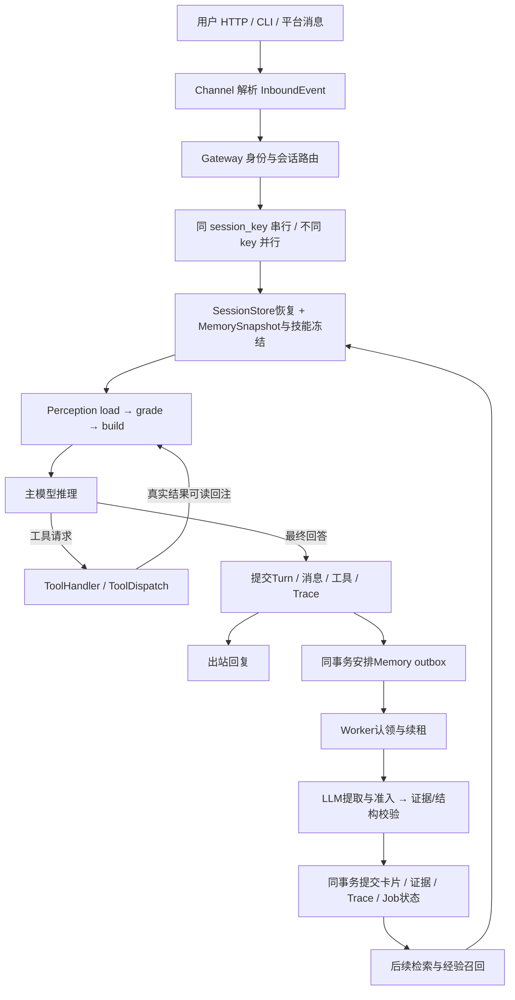

# 核心模块结论、真实消融与架构面试说明

日期：2026-10-11。当前结论适用于工程作品和单机 Agent 原型。模块边界基本合理，没有发现需要推倒重写的结构问题；不能据此宣称已完成生产高并发、开放域记忆准确率或全量最终验收。

当前源码：Python 全量465项通过；前端11项通过，类型检查与生产构建成功。消融28个隔离数据库均 integrity_check=ok、外键无错误。开发库140道版本化题目，已保存28条本次消融结果。原开发库备份仍在 `data/agent.pre_long_repair.20261011-034339.db`。

## 一、最终修改结论

1. 原文和投影分离：消息、工具原始参数/解析参数、文本/结构化结果、状态、错误和时间完整落库；perception的裁剪只影响模型视图。每次主模型请求、工具schema、迭代、重试usage和压缩决策可审计。缺失usage保持NULL。
2. 工具身份分离：持久事实ID负责检索与证据，provider调用ID负责assistant/tool协议配对。失败或未完成的工具调用不能让旧成功事实过期。
3. 预算一致：消息、工具schema、输出预留统一计入；提取、准入及修复按完整提示词计算来源分块。工具结果按剩余预算分页，重复日志只合并连续完全相同的行，独有中段/尾部保留，数据库原文不变。
4. Memory先判别后建卡：提案必须有保存理由、未来用途和真实来源；独立准入、逐字引文、类别/数字/成败校验后提交。单次有价值的成功/失败/混合经验允许保存，临时任务、第三方资料和未验证猜测跳过。固定项目排期与个人偏好区分，期限关联保存父卡ID和revision并在提交时检查。
5. 存储首批简化：移除闲置revision_ref/tokenizer_name，message_count派生；核心JSON列按session/turn/message/tool_call命名；duration_ms、result_data、finished_at、error_text统一。既有迁移保持不变，通过010迁移更新。
6. 版本化评测：五个题库版本、91个场景、140题，其中新增48个40–80轮场景、96题。题目内容版本随dataset_version，字段契约单独question_schema_version，结果绑定question_hash。标准只进入独立评分调用。
7. 工具输入可读：来源ID、角色、时间、正文、状态和分页明确分区；result_data保留机器结构，result_text供模型阅读。仅结构化返回也生成文本；error-only事实能重启后读回。原始JSON文件的显式文本原样保留。

不把“所有字段都有列”当作完成：查询列用于筛选/索引，领域JSON用于完整恢复；这是一种有意的冗余。生产中保存最终提案/证据/跳过决策和辅助调用metadata；评测额外录制所有实际模型请求与原始响应，不能混称生产库完整保存每个辅助模型中间输出。

## 二、消融设计与数据

使用同一模型 deepseek-v4-flash、同一冻结题目和历史截止，选择7个q2检查点：两个60轮perception场景、四个40轮组合场景、一个40轮第三方资料负例。每个检查点运行P0M0、P0M1、P1M0、P1M1，四组共28次回答。

- P0：完整跨会话历史，只做协议组装和预算检查，关闭分级、过期裁剪、Anchor。P1：生产perception，20k上下文预算。
- M0：关闭长期卡片读取及经验注入，保留原文检索。M1：启用长期卡片及记忆提示。保留原文检索是为了不同时移除perception的读回通道。
- 建卡一次，四组使用其前问答数据库快照；答案不污染其他组。所有参考答案仅发送评分调用，原始答案不改写。
- 一轮小样本消融，不是多次重复的统计显著性证明。评分是同一模型的独立调用，有模型偏差风险。

| 条件 | 答案正确 | 整轮主模型输入tokens | 主模型输出tokens | 主调用数 |
|---|---:|---:|---:|---:|
| P0M0：两者关闭 | 7/7 | 83,000 | 2,940 | 9 |
| P0M1：只有卡片 | 7/7 | 72,448 | 2,685 | 8 |
| P1M0：只有perception | 7/7 | 51,666 | 5,431 | 18 |
| P1M1：两个启用 | 7/7 | 44,389 | 4,226 | 16 |

**Perception的可支持结论：固定M1后，主模型整轮输入减少28,059 tokens，节省38.73%；固定M0后节省37.75%。** 包括全部主模型迭代/重试，不只比较第一次请求。

| 场景（M1固定） | P0输入 | P1输入 | 整轮节省 |
|---|---:|---:|---:|
| Anchor复用/失败状态 | 11,776 | 2,320 | 80.30% |
| 保留期/索引更正 | 11,782 | 2,299 | 80.49% |
| 职业更正/手机偏好 | 10,817 | 5,888 | 45.57% |
| 笔记本预算/条件 | 10,822 | 8,787 | 18.80% |
| SVG单次失败/处理偏好 | 10,839 | 8,838 | 18.46% |
| 备份混合结果/安全要求 | 10,822 | 9,088 | 16.02% |
| 第三方资料负例 | 5,590 | 7,169 | -28.25% |

不能宣称每个场景都省30%。短输入或需要多轮读回时，固定提示和工具往返可能抵消压缩收益。两个大噪声perception场景约80%的节省，才是最清晰的收益样本。

**辅助调用不能隐去。** P1M1的Anchor输入31,094、输出6,609 tokens。加上Anchor输入后，输入合计75,483，相对P0M1的72,448反而增加4.19%；输出也增加。这轮冷启动实验只证明主模型输入变小，尚未证明总token/费用更低。Anchor跨后续问题复用可摊销，但这里没有测出长期摊销曲线。缓存输入仍计token，不能直接当作费用比例。

Memory一次建卡的100次提取/准入调用累计输入274,228、输出38,916 tokens，覆盖五个40轮记忆场景；费用需要长期复用摊销。两个perception-only场景未启用提取，存储层有待处理outbox，不计为记忆提取失败。

## 三、Memory精度的三个口径

| 指标 | 定义 | 本次结果 |
|---|---|---:|
| 提取召回率 | 正确保存的预期事实 / 应保存事实 | 9/9，100% |
| 卡片识别Precision | 匹配黄金事实的实际卡片 / 全部实际卡片 | 9/9，100% |
| 检索Recall@5、@10 | 自然问题能检索到的正确已建卡 / 正确已建卡 | 均9/9，100% |
| 禁止/额外卡片 | 独立评分标记的误建卡片 | 0 |
| 第三方负例误建 | 无需建卡的检查点是否留下卡片 | 0/1 |

检索Recall@K的分母是“已正确建出的卡片”，不能拿它代替提取召回；若提取漏卡，检索可能仍是100%。本次两者分别测量，均为9/9。

四个有卡片的组合场景，在P1固定时，M0主输入35,623，M1为32,601，减少3,022，8.48%。部分场景卡片检索减少查询，部分增加验证往返。四组答案均正确，因此本次不能说Memory提高了答案正确率；已证明的价值是持久化提取、正确归属、更正后的事实组织和按需检索。

更大范围的历史证据：旧v13完整96题答案94/96=97.92%、提取70/77=90.91%，24道纯负例零卡；但存在准入预算失败及禁止卡，因此不是最终全量验收。v14重点8题14/14事实、8/8答案、零违规；本次是当前源码的独立四组消融。旧版本、不同范围的数据不能拼成一次“全量100%”。

本次已测：所有28次回答完成、原文不变，五个记忆场景的50个提取作业全部完成，28个消融库完整性/外键通过。尚未证明：当前最终源码96题全量全部门槛通过、每个噪声组合场景整轮节省30%、真实用户分布泛化、高并发/多进程故障恢复及长期净费用收益。用户更新的90%质量阈值已保留，未改题目和答案。

## 四、完整数据流

1. **入口与装配。** `agent/main.py`启动HTTP/CLI，`agent/runtime.py`装配ModelRegistry、工具/技能、SQLite、Memory、可选Action、Perception、Loop和Gateway。Loop不知道渠道协议，ModelRegistry隔离provider差异。
2. **身份与并发。** Channel生成SessionSource；Gateway生成session_key负责本会话排队，MemoryScope负责跨会话归属。DM按渠道+用户共享长期记忆；群聊使用群scope，不能生成个人用户卡。Scope由运行时传给工具，不接受模型自己指定别人的scope。
3. **每轮快照。** Gateway恢复Session，冻结Markdown规则/手册及少量关键词经验；Loop冻结技能、工具集合和执行上下文。手册不等于所有卡片常驻，身份/偏好/项目卡仍按需搜索。
4. **Perception。** load把系统、技能、记忆和历史统一为ContextItem；grade按P0/P1/P2/P3与预算决定保留、Anchor替代、延期读回或丢弃；build生成实际messages。P0是系统/技能/手册等固定规则；P1保护失败信息、当前重要操作及经验；P2是历史对话、近期原文和Anchor；P3是可按引用恢复的资料。分级依据具体item，不能只按role机械套级别。
5. **ReAct循环。** 主模型返回文本或工具请求。工具请求写assistant协议消息，再执行并写tool消息，重新构建上下文。schema、消息和输出预留一起受预算约束。主模型瞬时失败/空答有限重试，不把空答当完成。
6. **工具执行。** 基本路径检查工具与参数；Action路径额外有工具集、PRE、幂等账本、执行/POST、发布和恢复。执行成功、结果可发布、对话提交成功是不同状态；超时导致外部结果不明时不能盲目重复写。
7. **事实提交。** Loop返回TurnResult后，Gateway/SessionStore原子提交本轮原文、工具事实、状态、Trace和记忆调度。提交成功后才finish pending Trace、通知后台。SSE是观测，不等于数据库事务已成功。
8. **异步记忆。** 调度器按scope累计在1、3、6、10轮及之后每5轮形成批次，reset/停止时flush。Worker领取持久Job、续租，模型调用在事务外；校验后的提交把卡片、证据、Trace和completed状态同事务写入。重试历史继续保存。
9. **冲突与生命周期。** 事实使用kind/subject/attribute槽位；重复合证据，更正替代旧卡，不确定冲突保留原值并记录。经验不共用事实槽。卡片revision用于CAS，valid_from/until用于时效，deleted用于遗忘并防旧证据复活。
10. **下一次回答。** Retriever先按scope/status/有效期筛选；目前是关键词与中文二元组匹配，未实现语义向量RAG。搜索给引用/片段，read分页原文或卡片，edit仅在用户明确更正/删除时执行。读回统计只记实际曝光且被读回的来源。

## 五、三条主线必须分开理解

| 主线 | 保存什么 | 生命周期 | 不等于什么 |
|---|---|---|---|
| 原始事实 | 消息、工具参数/结果/错误、执行时间 | 审计与恢复的基础 | 不能被模型摘要替换 |
| 工作上下文Perception | 有预算的本轮投影、Anchor、读回引用 | 每次模型请求重建 | 不是永久用户记忆 |
| 长期Memory | 有证据的身份、偏好、阶段事实、经验 | 跨会话、可更正/删除/过期 | 不是每句话都存卡或全文RAG |

还有三个ID概念：session_key是路由槽；session_id是实际会话；scope_key是跨会话归属。工具也有provider调用ID和持久事实ID。混用这些ID会导致协议错配、跨用户泄漏或查不到原文。

## 六、面试官可能怎样拆解

| 追问 | 你应解释的设计与取舍 |
|---|---|
| 为什么不把全部历史塞给LLM？ | 输入预算、重复资料、噪声、迭代成本。给38.73%整轮主输入实测，随后主动说明Anchor成本抵消冷启动收益。 |
| Perception和Memory有什么不同？ | 前者控制本次发送什么，后者判断以后值得记什么；都依赖原始事实库，但生命周期不同。 |
| 为什么不直接截断最后N轮？ | 最早的决定可能仍有效，中段有偏好，末尾有更正。分级保护、来源绑定的Anchor与原文读回支持恢复；仍存在模型漏提取风险。 |
| Anchor错误怎么处理？ | 版本、覆盖范围、来源与预算校验，失败降级保护原文或明确构建失败；来源有效不代表语义必然正确。 |
| LLM判断值得记，可信吗？ | LLM只提案；来源ID、逐字quote、名称/数字、敏感内容、类别、成败和scope由代码检查，准入再审。多次模型一致不是事实证明。 |
| 如何避免第三方身份变成用户资料？ | 明确主体、排除虚构/第三方、禁止由归属排除反推负向偏好；用负例误建率验证。 |
| Memory“召回率”到底指什么？ | 分清提取Recall、卡片Precision、检索Recall@K、最终回答正确率。引用9/9与样本范围，别把答案正确当卡片已保存。 |
| 新旧事实冲突怎么办？ | 同槽位与证据时序/权限判断、CAS修订、superseded与conflicts；模型confidence不能代替用户授权。有限文本判别规则仍需更多开放表达测试。 |
| 为什么用outbox？ | 业务事实提交和安排提炼在同事务，避免写完事实却丢通知；worker可重启续租。是至少一次消费配合幂等提交，不保证外部副作用严格exactly-once。 |
| 两个人同时操作怎么办？ | Gateway同key串行、不同key并行；不可把每轮context放到共享Loop字段。SQLite短连接、WAL、短写事务和revision防冲突；进程内队列/锁不能代替多进程协调。 |
| SQLite为什么够用、何时不够？ | 单机方便、事务与调试简单；写入仍受串行约束，搜索instr扫描不适合大规模。后续需负载数据决定FTS/向量索引、外部队列及服务型数据库。 |
| 保存查询列又保存JSON不是冗余吗？ | 查询列负责索引和关联，JSON负责完整领域恢复；Store统一写入与回归约束，承认双写一致性是维护成本。 |
| 失败工具是不是可以自动重试？ | 读可重试与写副作用不同。Ledger记录started/unknown并核对外部状态，不能把网络超时当作没有发生。 |
| Scope是否就是认证？ | 不是。HTTP已有Origin白名单/可配置Bearer、非本机必须token；这是操作者接口，允许调用者指定身份，不是完整公网多租户IAM。 |
| 为什么没有直接用向量库？ | 当前可解释关键词检索+LLM改写查询足够做原型；没有证明开放域同义词和大语料召回。需要查询标注后比较关键词、FTS与向量检索。 |
| 如何证明优化效果？ | 冻结题目/截止、同模型四组、实际usage含重试、单列辅助与读回成本、原文不变/外键审计，保留失败，明确小样本和同模型评分偏差。 |

## 七、可以这样介绍项目

“我做的是一个能审计和恢复的单机Agent运行时。同步链路把渠道、会话排队、ReAct、上下文预算和工具执行分开；后台从已提交的真实对话中选择性构建有来源的长期卡片。Perception控制每次模型请求的上下文，Memory控制跨会话知识的生命周期。小样本四组消融中，固定Memory后主模型整轮输入减少38.73%，但我单列Anchor与记忆提取成本，没有宣称整体费用同步降低。记忆样本的提取、识别和自然问题检索均9/9，后续需要更大真实语料和人工复核。”

阅读顺序：`main.py → runtime.py → gateway/session_key.py、memory_scope.py → gateway.py → agent_loop.py → perception_engine.py、perception_anchor.py → tool_handler.py、tool_dispatch.py → session_store.py → memory_review_scheduler.py、memory_review_worker.py → memory_extractor.py、memory_batch_reviewer.py、memory_validator.py → memory_review_committer.py、memory_retrieval.py → eval/long_dialogue.py`。

原始消融：`data/evals/core-ablation-20261011-final/report.json`；指标：`summary.json/md`；每条件实际请求/响应：各目录`model-calls.jsonl`；数据库校验：`storage-audit.json`；入库记录：`database-import.json`。复现入口为 `scripts/run_core_ablation.py` 与 `scripts/summarize_core_ablation.py`。
