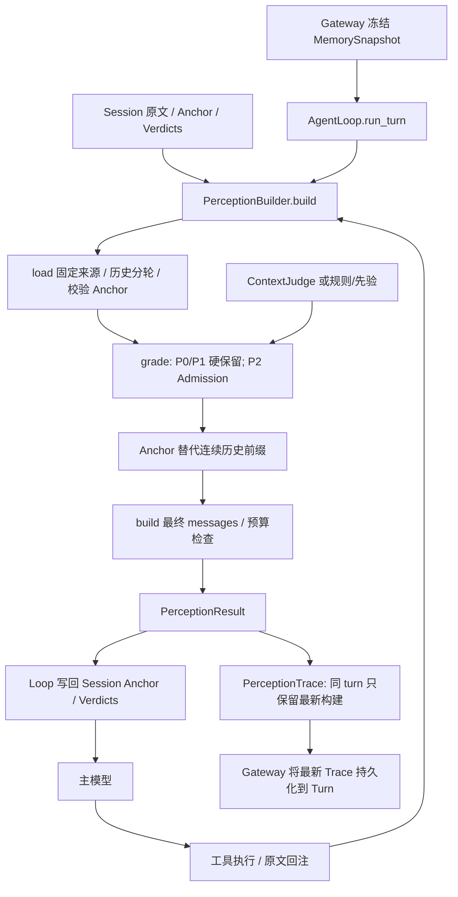

# Perception 逻辑审查与字段识别方案

> 这是清理前的审查记录。最新实施情况见 [perception_cleanup.md](perception_cleanup.md)；当前 inventory 已按迁移后的类型路径重新生成。

> 文中的审查结论和位置标签属于历史实现；源码链接只定位当前文件，清理前的行号不再作为跳转目标。

审查日期：2026-10-09（Asia/Shanghai）。审查的是当前工作区，包括尚未提交的 Admission/Judge 改动。

结论：主链基本统一为 `PerceptionBuilder.build`，没有发现多个独立的生产 Perception Engine。真正需要收敛的是：**没有生产来源的 P3 分支、重复的读回处理、只为兼容保留的 Interface，以及只能看到最后一次构建的 Trace**。不能把“没有显式 `.field` 读取”直接当作无用字段：不少字段通过序列化、SQLite、通用调试表格实际被消费。

本次只增加审查文档和静态盘点工具，没有修改生产逻辑。审查过程中 `core/types.py` 曾临时新增第二份 `AdmissionPlan`，因未定义的 `ContextItem` 导致导入失败；最新版本已移除该重复定义，核心测试重新通过。这一临时问题不列为当前未修复问题。

**1. 当前实际执行结构**



当前各文件承担的工作：

| 文件 | 实际职责 | 判断 |
| --- | --- | --- |
| `perception_engine.py` | 加载、历史分轮、优先级、Anchor 覆盖验证、预算、组装、记录 | 主要复杂度集中在这里；需要拆清内部阶段，不需要再造一个 Engine |
| `perception_admission.py` | 历史工具输出准入、规则/分数、投影、定案、读回反馈 | 已有生产接入，不是仅有设计 |
| `perception_judge.py` | 小请求模型、判官 Interface、System One Adapter | 已由 provider/main 装配；请求字段都被发送，不能因本地没有决策读取就删除 |
| `perception_anchor.py` | 模型生成五槽、解析、主模型渲染 | 已实现；模型负责语义合并，运行时负责结构、来源、错误和预算校验 |
| 历史类型文件（已拆至 `context_item.py` 与 `agent/types/perception/`） | 运行期 ContextItem、策略、记录、指标、返回值 | 混合了运行、诊断、兼容三种生命周期；不是所有模型都应当视为公开协议 |
| `perception_trace.py` | 进程窗口、最新构建、P3 回取率 | 已接调试与持久化，但中间构建和构建失败无法完整追溯 |
| `core/types.py` | Session 持久数据、Anchor/事实、AdmissionVerdict | 持久模型适合放这里；`AdmissionPlan` 依赖 Perception 内部投影，适合留在 Perception 内部 |

**2. 按生产可达性识别的冗余**

静态盘点扫描了 239 个 Python 文件，Perception 内有 92 个函数/方法定义；连同关联的共享模型、内部计划和预算，记录了 21 个带注解的数据模型/协议、170 个字段定义。170 不是公开协议字段数量，也不是无用字段数量。

| 对象 | 证据 | 处理建议 |
| --- | --- | --- |
| `_origin_ref(kind, message)` | [engine:1137](D:/111agent_wjc/DemoCursor/agent/core/perception/perception_engine.py) 恒定返回 `None`，参数不参与结果 | 确认是空实现，可去掉函数和调用，使用字段默认值；若恢复来源追踪，先实现真实引用来源 |
| `PerceptionTrace.record_p3_hit` | [trace:88](D:/111agent_wjc/DemoCursor/agent/core/perception/perception_trace.py) 没找到生产或测试调用；功能与 `record_memory_read` 重叠 | 保留一种成功读回的 Interface，删除这个无人使用的入口 |
| `PerceptionResult.context_anchor_payload` | [types:174](D:/111agent_wjc/DemoCursor/agent/types/perception/result.py) 只有压缩测试使用；生产 Loop 直接写 `result.anchor` | 测试改用与生产一致的 Anchor Interface 后，可以删除便利属性 |
| `PerceptionResult.summary` | [types:181](D:/111agent_wjc/DemoCursor/agent/types/perception/result.py) 没找到针对这个属性的实际调用；同名 `Session.summary`/Memory 卡片字段会掩盖简单名字搜索 | 可删除这层旧调用方兼容渲染；不要同时删除仍参与旧数据迁移的 `Session.summary` |
| engine 的 `import re` | 本文件未读取该符号 | 可直接清理 |
| P3 分支及其观测 | [engine:603](D:/111agent_wjc/DemoCursor/agent/core/perception/perception_engine.py) 消费 P3；当前 `_load_nonhistory`、`_history_items`、Anchor 创建路径均只产生 P0/P1/P2 | 整组标为“生产不可达的预留逻辑”，不要把它描述成现有 lazyload 能力 |

`_load`、`_grade`、`_history_turns`、`_validate_anchor_content` 等大部分内部函数都有调用。私有函数只有一个调用方，或只是几行代码，并不能证明它冗余；来源验证、完整轮次和覆盖账本这些小函数承担了具体规则。

P3 的不可达判断限定于当前固定生产加载路径。子类重写私有加载函数、测试直接构造 ContextItem，或未来新增来源，都可以让分支可达；这些不构成当前生产已落地的证据。

**3. 相似逻辑的多种实现与实际问题**

| 问题 | 位置及证据 | 优先处理方式 |
| --- | --- | --- |
| **Action 的读回引用无法解析** | [ActionRuntime:86](D:/111agent_wjc/DemoCursor/agent/action/runtime.py:86) 生成新的工具事实 ID；[消息回注:77](D:/111agent_wjc/DemoCursor/agent/core/building_messages.py:77) 使用 `provider_tool_call_id`；[Admission:430](D:/111agent_wjc/DemoCursor/agent/core/perception/perception_admission.py) 将这个 ID 拼为读回引用；[Retriever:237](D:/111agent_wjc/DemoCursor/agent/core/memory/memory_retrieval.py:237) 按数据库事实 ID 查找 | 先统一可解析的引用。区分 provider 调用关联 ID 与持久工具事实 ID，用现有 `Message.tool_call_ids`/工具事实映射构造真实恢复引用；不要把同名 `tool_call_id` 当成跨模块恒等 ID |
| **工具成功读回处理分成两条，Action 漏掉钉住** | [Loop:264](D:/111agent_wjc/DemoCursor/agent/core/agent_loop.py:264) Action 分支只记录 P3 hit；[Loop:375](D:/111agent_wjc/DemoCursor/agent/core/agent_loop.py:375) 普通路径还调用 `_pin_readback` | 两种执行方式都经过一个“成功工具结果回注”内部入口，统一读回事件、反馈和 Message 创建 |
| **shadow 的读回被计为误判** | [Loop:323](D:/111agent_wjc/DemoCursor/agent/core/agent_loop.py:323) `_pin_readback` 不检查是否 active、是否确实裁剪过；shadow 定案也存在于 Session 中 | 仅对实际执行过的投影计误判。读回事件可照常记录，shadow 不应污染 active 的错误反馈/钉住状态 |
| **Token 估算有多种兜底，最终调用又绕过兜底** | [engine:57](D:/111agent_wjc/DemoCursor/agent/core/perception/perception_engine.py) 默认按 bytes；[engine:646](D:/111agent_wjc/DemoCursor/agent/core/perception/perception_engine.py) 和 [engine:1150](D:/111agent_wjc/DemoCursor/agent/core/perception/perception_engine.py) 各自按字符兜底；[engine:142](D:/111agent_wjc/DemoCursor/agent/core/perception/perception_engine.py) 最终直接调用 estimator | 为整个 build 选择一个一致的估算 Adapter。明确 tokenizer 故障是整次降级还是明确失败，避免中间估算成功、最终又抛原始异常 |
| 最终排序重复 | [engine:621](D:/111agent_wjc/DemoCursor/agent/core/perception/perception_engine.py) 与 [engine:778](D:/111agent_wjc/DemoCursor/agent/core/perception/perception_engine.py) 都对 selected 排序 | 最终构建处保留一次排序，并在这里生成真实发送位置 |
| 五槽结构多处重复列举 | `_ANCHOR_SLOTS`、`_anchor_content`、`_anchor_facts`、`render_anchor`、生成提示词 | 保留一份槽位及显示标题定义，序列化/遍历/渲染从它派生；提示词语义仍需独立审查 |
| `HistoryTurn` 类型别名重复 | engine 与 admission 都定义相同 tuple 类型 | 放到内部 types，一处维护；不是当前行为错误 |
| `_grade` 有最后一次补选/重复预算检查 | [engine:590](D:/111agent_wjc/DemoCursor/agent/core/perception/perception_engine.py) 在成功压缩、原文和 fallback 分支完成选择后，又尝试补齐 | 先明确每个输入条目必须得到一个最终 disposition，再用断言检查。不要用静默补选掩盖未定案，也不要未经验证删除防御检查 |

Anchor 的两种校验不是同一件事：`_validate_anchor_content` 验新生成的语义事实，`_validate_stored_anchor` 验缓存是否仍对应当前历史。Session 的类型恢复与 Engine 的覆盖/digest 校验也不能简单合并删除。可以集中基础解析，但要保留各自校验目的。

另一个规则问题：[_stale_reason:397](D:/111agent_wjc/DemoCursor/agent/core/perception/perception_admission.py) 只看后续调用请求，不看执行结果。同一读取再次发起但失败时，旧的成功输出仍会被规则判为 `score=0` 并 defer。应在确认后续成功读取/修改后，才声明旧结果已经被替代。

**4. 哪些协议字段需要清理，哪些必须保留**

| 字段组 | 当前用途 | 分类与建议 |
| --- | --- | --- |
| `ContextItem.message/priority/token_estimate/seq/is_error` | 实际选择、成本、顺序、保护错误 | 行为字段，保留 |
| `ContextItem.message_id/session_seq/raw_message` | 原文身份、覆盖边界、投影后仍对原文计算 digest | 正确性字段，保留；不是“只是多存了一份”的冗余 |
| `Anchor.version/session_id/covered_*/source_digest/anchor_id` | 验证版本、会话、连续完整前缀、篡改/失效、事实来源 | 正确性字段，保留。可推导不等于可无条件删除，缓存复用需要这些校验 |
| `AnchorFact.text/source_message_ids/status` | 语义、证据和失败状态 | 保留；Pydantic 的版本/额外字段验证也是实际消费者 |
| `AdmissionVerdict.action/score/missed/tool_call_id/message_id` | 投影、升档、读回钉住、匹配身份 | 保留；先修复其中 `tool_call_id` 的身份含义 |
| `AdmissionVerdict.kind/still_needed` | 定案后不再读取它们来决定行为；分数已计算完成，但整体 Session 序列化会保存 | 诊断字段。Trace 完整后可移到判定事件，减轻持久状态；目前不要把“没有再算分”误写成“从未使用” |
| `AdmissionVerdict.source/reason` | 解释投影、miss 事件、诊断 | 有实际消费者。若改结构，应保持解释链，不要只留下分数 |
| `ContextJudgeRequest` 的 7 个字段 | item_id 对齐返回值，其余形成远程 state | 判官协议字段，当前都有用途；不是仅有定义 |
| `ContextJudge.id` | `main.py` 装配日志 | 已使用；可以是诊断属性，但不是死字段 |
| `PerceptionRecord.content_preview/content_chars/admission_*` | Trace 序列化、持久化、通用表格 | 观测字段；即使 AST 没有显式读取也不能判死 |
| `PerceptionMetrics` 的预算、Anchor、Admission 指标 | `event_data()`、滚动窗口、`model_dump()`、调试表的 `metrics.items()` | 大多有观测用途。应精确定义计数含义，不能整批删除 |
| `origin_ref`、`exposed_refs`、`p3_hit_refs`、`p3_exposed_count`、P3 hit rate | 依赖目前不存在的 P3 生产来源 | 休眠字段组；选择整组移除，或先真正实现来源和恢复闭环 |
| `dropped_count/deferred_count` 及其 p95/p99 | 当前仅统计 P3 handle；P3 不产生，所以正常生产构建为 0 | 休眠观测；不代表 Admission defer 数量 |
| `p0_dropped_count/p1_dropped_count/protected_error_missing_count` | 当前 P0/P1 全部硬保留，超预算先抛异常；成功结果中按现有算法为 0 | 改为失败 Trace 的规则结果或断言；当前成功构建计数无法观测真实失败 |
| `Session.summary` 与 legacy 解析 | 读取旧五槽文本，作为迁移提示 | 兼容字段，确实被读。检查存量数据并完成迁移后，再清理 |

此外，`deferred_count` 和 `p3_exposed_count` 当前都等于 `len(lazyload)`，是同一数量的两种名字。Admission 的 defer 则是工具正文被占位符替代、工具消息仍保留；它没有变成 P3 `ContextItem`，也不会进入 `exposed_refs`。这两个概念应明确区分，或统一为“投影及其可恢复引用”，不能继续用含混的 defer 名字联想它们已互通。

`AdmissionPlan.missed` 是对 Session 中所有存量 verdict 的累计求和；`admission_judged_count`/latency 则是本次 build 的值。它们混在“单轮指标”里，容易被当成同一统计口径。先确定哪些是本次、哪些是会话累计。

**5. register 和设计文档是否真正落地**

当前 `perception/` 没有 `register` 函数或 Perception registry 文件。若指 Memory 的文档 register，它已实现：

```text
main.py:143 创建 MemoryContextLoader(document_registry=storage.documents)
→ RuntimeStorage.documents = SqliteDocumentRegistry(database)
→ MemoryContextLoader.freeze:136 / 152 调用 register(snapshot)
→ SqliteDocumentRegistry.register:16 写 context_documents
→ MemoryRetriever 搜索/读取已登记 document 引用
```

它是实际检索元数据登记，不是把 document 自动变成 P3；这两条功能不能混为一谈。`DocumentRegistry(Protocol).register` 的 `...` 是协议声明，真实实现是 SQLite Adapter，不能按空函数删除。

对本地 `perception_plan.md` 与实现的对照：

| 设计想法 | 当前状态 |
| --- | --- |
| load → grade → build 唯一入口 | 已实现 |
| Anchor 自动压缩、持续合并、覆盖账本、两次尝试、失败降级 | 已实现；语义是否正确合并由模型承担，运行时验证结构/来源，不是完整的语义证明 |
| Observation masking + Anchor | 已实现为 Admission trim/defer 再 Anchor；Anchor 输入允许使用投影，这是现有测试明确支持的行为 |
| repo/log/doc/table/file 等通用 P3 handle | 没有当前生产来源和通用 resolver；现有 Memory 原文引用体系是 card/message/tool/document |
| 按任务语义识别 P0/P1 的关键文件、失败测试、接口证据 | 当前主要按固定来源、user 位置和 ReAct 阶段分级；不是任务语义分诊 |
| 每个优先级各自预算及统计 | 部分实现：总输入预算、Anchor 15%/2048 上限、P0 10% 告警；P0/P1/P2 独立份额与完整统计没有落地 |
| 最近两轮始终原文 | Anchor 阶段保留最近两轮；active Admission 仍可 trim/defer 这两轮中的旧工具输出，需要在文档中说明这个例外 |
| 工具介绍也计入上下文预算 | Perception 估算 messages；tool schemas 在 `_chat_with_retry` 中另行附加，目前未纳入同一估算 |
| 完整追查“来源、为什么进来、最终位置、为什么重新取回” | 部分实现：reason/preview/输入 seq 可读；实际发送位置、中间构建、失败构建、Admission 读回闭环仍有缺口 |

磁盘中的 `__pycache__` 还有旧 engine/context_triage 等文件名，它们不等于当前有多套源代码实现。本次盘点只统计 `.py`，没有把历史 bytecode 当作生产模块。

**6. Trace 当前缺口与最小收敛方案**

当前 Trace 的关键问题：

1. [Trace.record:51](D:/111agent_wjc/DemoCursor/agent/core/perception/perception_trace.py) 覆盖同 turn 的先前构建；[Gateway:316](D:/111agent_wjc/DemoCursor/agent/gateway/gateway.py:316) 只把最终这条写进 Turn。第一轮判了 3 条，第二轮复用定案判了 0 条，持久化只看到 0，不能还原实际判官成本和发生顺序。Anchor 的 created → reused、attempts/error 也会被覆盖。
2. `Trace.record` 只在成功构建结尾执行。第一次构建就预算失败或压缩失败时没有 Perception Trace；后续失败则可能只剩前一次成功构建。`turn_error` 事件不能提供逐条上下文失败原因。
3. `PerceptionRecord.seq` 是输入序号；压缩后可能有空洞，它不是最终 messages 下标。记录也缺少结构化 message_id 和压缩目标 Anchor 关联。
4. active Admission 后，记录的成本/preview 是投影后的版本，没有明确的原始成本和最终发送成本对照；shadow 的 action 又是“如果生效”的动作，容易与实际动作混淆。
5. Admission 的恢复引用不进入 P3 exposed_refs，当前 P3 hit rate 对这类读回恒不命中。

建议保留 **一个构建入口、一份最终条目定案、一套工具结果反馈**：

```text
Session 原文（事实）
→ load 形成运行期 ContextItem
→ admission 形成临时投影计划
→ anchor 替代连续前缀
→ finalize 生成最终 messages 和最终 ItemDecision
→ 从同一 ItemDecision 派生 metrics 与 trace
```

避免 `selected/lazyload/dropped/reasons/records` 长期各自维护平行事实。运行阶段可以有临时计划，最终只能有一份权威定案，再从它派生返回值和观测。

Trace 用 `session_id + turn_id + iteration` 关联每次构建；直接使用现有 iteration，不引入另一套无消费者的 trace ID。滚动窗口仍按 turn 计算 p95/p99，完整构建明细单独保留/持久化。构建失败也产出 status/error/stage 和已经得到的条目定案。

每条记录按实际问题增加信息，而不是一次性新增大协议：

| 需要回答的问题 | 最小信息 |
| --- | --- |
| 来自哪条原文，能否读回？ | 现有 message_id + 真正可解析的 source/recovery reference |
| 为什么保留、投影、压缩或移出？ | 一份 final decision/reason；Admission action 明确是否实际 applied |
| 省掉了多少？ | 原始 tokens 与最终发送 tokens；阶段计数由记录派生 |
| 最终模型看到它在哪？ | finalize 后的 message 下标；被压缩的条目关联现有 Anchor ID |
| 何时读回、是否真的误判？ | 成功 readback 事件；只有实际投影才标记 miss |

P3 如果近期没有计划接入，就删除它的生产分支、闲置 Interface 和指标组；如果要保留，必须先有能产出条目的来源、稳定可解析引用、暴露记录及成功恢复反馈。仅增加 enum、origin_ref 和 hit rate 不能算完成。

**7. 可重复执行的识别方法**

工具：[audit_perception.py](D:/111agent_wjc/DemoCursor/docs/audits/perception/audit_perception.py)。结果：[perception_inventory.json](D:/111agent_wjc/DemoCursor/docs/audits/perception/perception_inventory.json)。运行不导入应用、不读 `.env`、不调用模型或网络，只解析源文件并更新旁边的 JSON：

```powershell
.venv/Scripts/python.exe docs/audits/perception/audit_perception.py
```

JSON 记录定义位置、生产/测试的名字引用、字段显式读取/写入样例、序列化入口、空返回函数、未引用候选、重复模型名，以及目标源码 SHA-256，便于确认之后的报告是否仍对应同一版本。

识别顺序：

1. **静态找候选**：没有生产符号引用、只在测试出现、恒定返回、重复定义、字段只写不显式读。排除 Pydantic 自动校验、Protocol 声明、属性序列化、动态 getter 和泛型表格误报。
2. **从真实入口验证可达性**：从 `main → Gateway → AgentLoop → build` 走到生产创建方和消费者。P3 是“有人消费、无人生产”；`register` 是“Protocol 声明有真实 Adapter 与注入”。两者需要不同结论。
3. **画字段生命周期**：`创建 → 改写 → 用于分支/校验 → 发送给模型/持久化/调试读取 → 过期`。标记为行为、正确性、诊断、兼容、预留、可推导六类。记录 owner 和最终消费者，不要求为每个字段另加运行期协议字段。
4. **用差异验证必要性**：对候选的删除/固定值改动，在隔离环境比较 messages、失败行为、Anchor 验证、Session 恢复、读回和 Trace。只比较模型 messages 会误删诊断和安全校验字段。
5. **按整条能力清理**：休眠 P3 应连同来源/投影/消费者/指标一起收敛；兼容属性要同步测试；持久字段先处理旧载荷兼容。避免删定义却留下固定为 0 的列和指标。

静态工具按符号名字匹配，不推断 receiver 类型。例如其他模块的 `.summary` 会让 `PerceptionResult.summary` 看起来“有人使用”；JSON 动态读取又会让有效字段看起来“无人读取”。输出是可核查证据和候选，不是自动删除清单。

**8. 验证结果与实施顺序**

最新工作区重新运行的 50 项相关测试全部通过，覆盖 Perception/Admission/Anchor、模型图片映射、Skill 预算、Gateway 预算和调试 Trace。首次运行有 4 项被沙盒的图片读取/本机 HTTP 限制阻断；允许测试所需的本机访问后通过。现有测试通过，不代表已经覆盖下述路径差异。

额外运行探针结果：

| 探针 | 观测结果 |
| --- | --- |
| active Admission defer 与 P3 | `admission_deferred_count=1`，`deferred_count=0`，`exposed_refs=[]` |
| 首次构建预算失败 | `trace_present=false`，窗口 `n=0` |
| 同 turn 的两次 shadow 构建 | 第一次 `judged=3`，第二次 `judged=0`，最终 Trace 只保留 `0`，窗口 `n=1` |
| Loop 的成功 Action readback（模拟 Action Adapter） | turn 正常完成，但原 defer 定案仍 `missed=false/action=defer` |
| 普通路径 shadow readback | 全文没有被移出，仍得到 `missed=true/action=keep` |
| 使用真实 SQLite 的 provider/fact ID 读取 | `tool:provider-call` 查不到；`tool:fact-call` 能读取 |
| 后续同一读取失败 | 旧成功结果被规则判为 `score=0/action=defer` |
| tokenizer 始终抛异常 | 条目估算走兜底，最终 build 仍抛 `ValueError` |

建议实施顺序：先修复读取引用及统一成功工具反馈，再修 shadow/失败重读规则；随后补齐构建明细与失败 Trace、统一估算和最终定案；最后清理无人使用的 Interface/P3 整组及迁移兼容。以可验证行为和消费者为准，不以函数个数或字段个数为目标。
