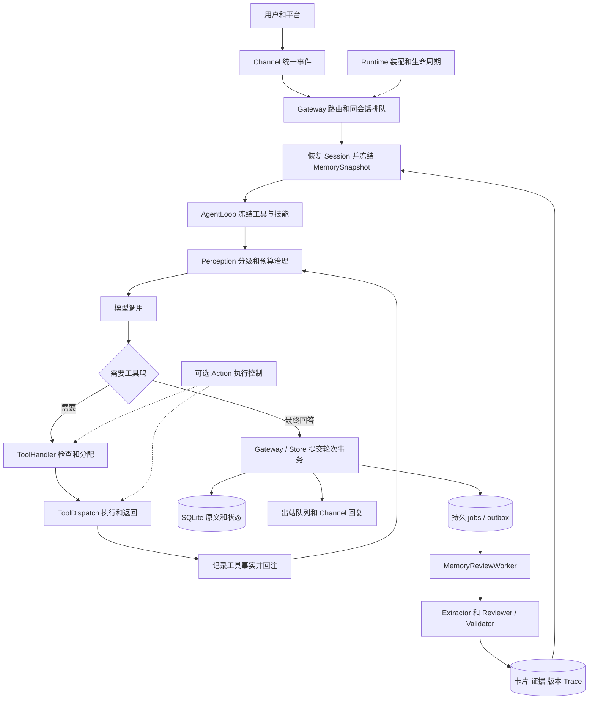
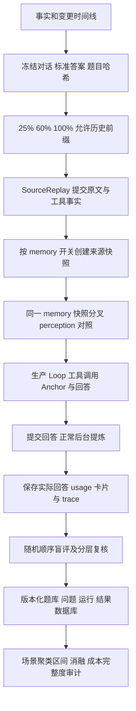

# 个人助手 Agent：架构与面试准备

核对日期：2026-10-11。以当前源码、装配入口及最新迁移为准。本文是面试学习材料，没有修改运行代码；引用的实测成绩来自仓库已有报告，本次没有重新调用远程模型或运行测试。

2026-10-12 补充：120 场景评测见 [评测说明](core-benchmark-120.md)。新的正式实验未结束时，不能把此前小样本或独立试运行数字当成 120 场景成绩。

面试官若追问两个核心模块的收益，可以按以下顺序解释实验：先冻结生产实现与答案，再用同一允许历史做四组消融；perception 的质量比较固定 memory 状态，连续复用的两组从同一份初始记忆快照分叉。memory 关闭时仍保留原文检索，因为原文读回是 perception 能力的一部分。这个实验开关与完全关闭生产 memory 工具的运行配置有所区别，必须主动说明。

token 节省要统计一次回答全部主模型请求，读回引发的第二、第三次调用也计入；再加 Anchor、记忆提炼、准入及修复，才能判断产品总成本。冷启动与连续第 1、3、6 问分别报告，裁判费用不混入产品费用。压缩失败导致没有主模型回答时，主输入很低也不能证明有效：正确率必须先达到门槛，配对下降的场景聚类置信区间还要支持非劣。

记忆的识别、保存和检索应分开回答。提取 Recall 表示必需事实漏了多少；卡片 Precision 表示实际保存内容中有多少值得持久保留且有证据；类别正确率检查信息是否进入合适类别；Recall@5 / @10 检查正确卡片能否被找到。更正、遗忘、到期以及成功/失败混淆单列，不能用一个总正确率遮盖这些边界。最后说明合成数据和同模型裁判的局限，以及失败样本、代码指纹、题目哈希和真实 usage 的保存位置。

## 0. 先修正原来的表达

你的理解已经覆盖两条主线：长对话上下文治理，以及后台长期记忆。需要修正的主要是模块边界、优先级和“已实现 / 默认启用 / 已验证”的区别。

| 原来的说法 | 更准确的说法 |
| --- | --- |
| Runtime 下面有几个模块，Perception 是整个核心 | Runtime 是装配和生命周期入口；AgentLoop 是单轮执行主线；Perception 是上下文治理核心；Action 是可选执行控制能力。 |
| Perception 一开始加载所有路径的文件 | 它接收 Session、MemorySnapshot 和 SkillSelection 等固定来源。Markdown 定位与读取由 MemoryContextLoader / MarkdownDocuments 完成，SkillRegistry 扫描技能目录。它不遍历整个工作区读取所有文件。 |
| P0 是提示词和记忆，P1 是最近几轮 | P0 包含系统提示、手册与约束、技能摘要、临时渠道提示和当前用户输入；P1 包含当前轮用户输入之后的模型 / 工具消息，以及自动召回经验；此前历史和 Anchor 是 P2。 |
| 最近两轮全部不压缩 | 最近两轮历史不参与 Anchor 的整轮压缩；active Admission 仍可能裁剪其中符合条件的长工具结果。 |
| JEV 做三种类别判定 | 三种是处理动作 keep / trim / defer；内容类别 kind 有 error、listing、content、log、data、other。 |
| JEV 给 kind 和 relevant 两个分数后加权 | Judge 返回 kind 与 still_needed。正常评分为 0.8 × still_needed + 0.2 × 本地词面 relevance；kind 主要用于缺少可信需要度时的类别先验兜底。 |
| 越往后越容易仅引用 | 直接依据是窗口占用率上升，而不是时间或轮数本身。默认在 50%、70%、85% 三档提高裁剪与移出阈值。 |
| Anchor 存最后一个 message | Anchor 保存五槽内容，以及连续覆盖的起止 seq、起止 message_id、轮数、原文 digest；结束 message_id 是覆盖边界。 |
| 再满时从头把全部消息重新总结 | 通常将旧 Anchor 与新增待覆盖历史合并，扩展连续前缀；保留最近两轮历史，不把当前轮一起总结。 |
| 工具召回之后永久保留全文 | 仅当成功回读 tool: 引用，且对应 trim/defer 实际在本轮构建中生效，才将旧裁决标记 missed、改为 keep，阻止 Admission 再裁剪。它仍可被之后的 Anchor 覆盖，不等于永久占用窗口。 |
| Memory 都存在 Session 里面 | Anchor / Admission 属于 Session 上下文状态；长期手册、用户卡片、原始事实、证据与版本由文件和独立数据表承载。 |
| scope.json 是鉴权 schema | MemoryScope 是数据归属与隔离结构；scope.json 是身份元数据。HTTP 访问控制、平台身份来源、Store / Tool 范围检查共同构成边界，JSON 文件本身不验证身份。 |
| 搜索范围是 card / experience / raw / all | source 是 all / card / history / raw；经验通过 kind=reusable_experience 筛选。raw 包括工具原文和已登记 Markdown。 |
| 四类卡片关键词命中就自动召回 | 自动召回仅限 reusable_experience，最多 3 张且受 token 预算约束；其他卡片与原文通常由工具按需搜索和读取。 |
| Loop 数 turn，Runtime 发消息给 Reviewer | SessionStore 在提交事务内按用户 scope 累计成功轮次，写固定批次 jobs；Runtime 提交后唤醒 Worker。Worker 领取任务，Reviewer 调用 Extractor / Validator，Committer 原子落库。 |
| Tool / Skill 就是拼进 prompt | Tool 通过独立 tools schema 描述可执行接口，再由 Handler / Dispatch 调用实现；Skill 先给摘要，再通过 use_skill 读取本轮冻结正文。 |
| Action 就是记录执行 | 它控制授权、版本、审批、幂等、资源领取、超时不确定状态、结果发布、恢复与计划验收。工具事实记录在基础模式也存在。 |

还要区分两种“层”：Policy / Project / User 是 Markdown 约束与手册的层次；手册 / 原文 / 卡片是按存储形态划分的记忆。P0–P3 是上下文装配优先级，不是数据库记忆层级。P3 存在懒加载句柄机制，但当前固定主链没有普遍把历史原文映射到 P3；Admission 的 defer 也不等于把消息改成 P3。

源码默认 Memory 开启、Action 关闭、Admission 为 shadow。shadow 会记录裁决与模拟节省量，但不修改实际输入；active 才应用投影。环境配置可以覆盖默认值。最近的真实 JEV 验收记录是 401，并未验证成功的远程裁决，规则与类别先验兜底已有验证。

## 1. 可以直接口述的整体架构

> 我做的是一个面向长期、多轮交互的个人助手 Agent。用户会跨很多轮补充需求、改变偏好，工具也会产生大量输出，所以我重点解决的是三件事：当前任务能接着做，跨会话信息能查回来，执行结果能追溯。
>
> 启动时 Runtime 把模型、SQLite、工具、技能、Memory、Perception、Loop 和 Gateway 装配好，并管理后台 Worker 的启停。不同平台的消息先由 Channel 转成统一事件，再交给 Gateway。Gateway 负责会话路由、同会话排队、简单命令和会话恢复；不同会话可以并行，同一会话按顺序执行，防止历史状态互相覆盖。
>
> 一轮请求开始时，Gateway 根据来源建立用户 scope，恢复 Session，并冻结这一轮的手册和命中经验。Loop 再冻结可用工具和技能。之后每次调用主模型前，都由 Perception 统一合成上下文。系统约束和当前输入优先保护，历史先对长工具结果做可回读的准入处理，压力继续上升时，再把更早的完整轮次合并成结构化 Anchor。
>
> 模型如果需要工具，会先生成调用请求，Handler 做执行前检查，Dispatch 执行并返回结果，Loop 把事实回注后继续调用模型。启用 Action 时，这里还会有执行账本、幂等、版本与审批检查，遇到写入超时会保留 UNKNOWN 并查证，避免直接重发。模型给出最终回答，或者达到迭代上限，这一轮才结束。
>
> Gateway 最后把会话状态、消息、工具事实、轮次信息和后台记忆任务交给 SQLite 提交。后台从已经完成的对话里选择性提炼个人资料、稳定偏好、持续事实和可复用经验，核对原文证据后保存。原文一直保留，摘要和裁剪只影响送给模型的视图。以后遇到缺失信息，助手可以搜索卡片或历史，再按引用读原文。

讲完这段后，优先展开 Perception、Memory 和 Action；这些最贴近长对话个人助手的难点。

## 2. 模块分类与连接

| 类别 | 模块 | 负责什么 | 为什么这样划分 |
| --- | --- | --- | --- |
| 运行装配 | Runtime | 依赖装配、能力开关、启停、提交后通知 | 业务模块通过注入连接，避免各自创建模型和存储。 |
| 接入与调度 | Channel、Gateway | 平台适配、入出站队列、会话路由、命令、请求提交 | 平台变化不影响 Loop；同会话保持顺序。 |
| 单轮编排 | AgentLoop | 用户输入、上下文构建、模型调用、工具回注、完成判定 | 一次用户请求可以包含多次模型迭代。 |
| 上下文治理 | Perception | 固定来源加载、分级、Admission、Anchor、预算、渲染 | 在有限窗口里保留任务连续性。 |
| 长期记忆 | Memory | Markdown 快照、检索读取、卡片编辑、后台提炼校验 | 兼顾稳定约束、精确回忆与跨会话积累。 |
| 能力表达 | Tool、Skill | 可执行接口与可复用操作流程 | Tool 提供动作，Skill 提供完成任务的方法。 |
| 执行控制 | Action | 守卫、账本、幂等、恢复、补偿、计划和工件验收 | 多轮重试和模型误判不能直接变成重复副作用。 |
| 基础设施 | Model / Provider、Storage、Types、Trace / Eval | 协议适配、持久化、共享契约、可观测与评测 | 模型可替换，数据可恢复，结论有证据。 |

图中的 Cards → Freeze 只表示命中经验的自动注入。资料、偏好、持续事实及原文主要通过 memory_search / memory_read 进入本轮工具结果。

## 3. 每个模块怎么向面试官解释

### Runtime：把模块接起来

> Runtime 相当于应用的装配入口。我把模型、存储、工具和上下文模块作为依赖接进来，在一个地方控制能力开关和生命周期。这样 Memory 或 Action 关闭时，基础对话和 SQLite 会话恢复仍然可用；开启 Action 时，再加载它的实现和表。Runtime 还负责提交后的后台唤醒，但它不负责决定一张卡片该不该保存。

Runtime 自身不是业务数据表；它创建 RuntimeStorage、EventBus、PerceptionTrace 等实例。启动时可选 Action 先恢复遗留动作，再启动 Gateway 和 Memory Worker；停止时停止入口、刷新剩余记忆批次并关闭执行资源。

**追问：为什么不全部写进 Loop？**

Loop 只应该知道如何完成一轮请求。模型如何创建、数据库如何打开、后台线程何时启停属于应用生命周期；分开以后也更容易替换模型与执行策略。

### Channel / Gateway：把平台差异和会话顺序处理掉

> Channel 把 CLI、HTTP 前端、飞书、QQ、微信的消息统一成 InboundEvent，里面有正文、附件和来源。Gateway 不再处理平台协议，而是根据 session_key 找到当前会话，按同会话顺序排队，处理 /help、/new、/reset，普通输入再进入 Loop。执行完它负责提交并把统一回复交回 Channel。

来源结构的关键字段是 channel、chat_id、chat_type、user_id、thread_id、reply_to_message_id；附件记录类型、路径、名称、MIME 和大小。platform metadata 是扩展信息，主链使用明确的数据结构，而不是任意 dict 贯穿所有模块。

HTTP Token 与平台侧校验发生在入口层；Gateway 建立归属范围，工具与存储继续检查范围。当前 HTTP 使用 API Token 访问控制，Frontier 的 user_id 来自请求映射，尚不能描述为完整的登录用户身份系统。

**追问：session_key、session_id、scope_key 有什么区别？**

- session_key 定位平台上的逻辑聊天槽位，带 agent / channel / chat / user / thread 等信息。
- session_id 标识一个具体会话实例；/new 会产生新实例。
- scope_key 标识长期记忆归属，由稳定组织、租户、用户、项目字段计算，同 scope 可跨 Session 检索。

**追问：换会话和重启会不会丢记忆？**

提交成功的会话与原文从 SQLite 恢复；/new 切换 Session，但同 scope 长期记忆继续存在。当前个人 scope 包含 channel 维度，跨平台统一身份尚需额外绑定，不能说换到另一平台自动共享全部个人记忆。

### AgentLoop / Model：完成一轮请求

> 一轮指的是一条用户输入到最终回复，中间可以有多次模型调用。Loop 每次先用 Perception 构建上下文，调用模型；如果有工具请求，就执行、记录、回注，再进入下一次迭代。直到模型给出最终文本或者达到上限。它维护这一轮的身份和消息变化，持久化由 Gateway / Store 负责。

默认最多 8 次迭代；模型调用重试配置为 2 次重试。Model Adapter 统一 chat 请求与响应，具体协议、图像消息转换等留在模型层。更换模型不要求重写 Gateway。

**追问：为什么 Memory 和 Skill 要整轮冻结？**

一轮内部可能调用多次模型。后台记忆更新或技能正文修改如果中途改变输入，会让前后迭代基于不同规则。冻结快照给本轮一个稳定版本，新版本下一轮再使用。

**追问：关闭 Memory 是否关闭对话历史和上下文限制？**

不会。会话、消息、轮次和工具事实仍然持久化；Perception 的预算仍生效。关闭的是记忆快照、记忆工具与后台提炼 Worker。存储层的成功轮次调度记录 / jobs 基础设施仍由 RuntimeStorage 装配，不能说数据库完全不记录相关任务。

### Perception：有限窗口中的任务连续性

> Perception 是我专门做的上下文治理模块。它接收已经准备好的手册、技能摘要、当前输入和会话历史，统一转成上下文条目，先保护当前请求和执行现场，再根据预算治理旧历史。它不修改对话原文，只决定这一次发给模型的视图。

当前优先级如下：

| 级别 | 当前来源 | 策略 |
| --- | --- | --- |
| P0 | 系统提示、Markdown 约束与手册、Skill 摘要、临时提示、最新 user 消息 | 必须装入；保护项自身超预算时明确失败。 |
| P1 | 最新 user 之后的 assistant / tool 消息、自动命中经验 | 保护当前执行现场；记忆读取工具通过分页和返回预算控制长度。 |
| P2 | 此前历史、已生成 Anchor | 未覆盖工具结果可 Admission；更早完整轮次可 Anchor。 |
| P3 | 预留懒加载来源 | 仅暴露句柄；当前固定来源链未普遍产生这类条目。 |

上下文预算包含最终 messages 和 tools schema，并预留输出额度。代码默认总窗口 32768、预留输出 4096，实际配置可覆盖；估算成本和服务端计费 token 要分开。

**第一层：Admission，处理长工具输出。**

它只处理未被 Anchor 覆盖、已有轮龄、足够长且非错误的 P2 tool 消息；默认长度门槛为 2000 字符。用户消息、助手消息和 P0 / P1 不送判。规则先判断旧结果是否已被相同调用重跑、文件重读或修改而淘汰，再询问 Judge “这是什么输出，全文是否仍需要”。Judge 看的是有界状态与输出开头，不是整段全文。

- keep：保留全文。
- trim：保留首尾，省略中间，给回读引用。
- defer：用调用说明和原文引用替代正文。

正常评分为 `0.8 * still_needed + 0.2 * relevance`。relevance 是工具参数词项在后续对话中的词面命中比例。没有可信 Judge 结果时，使用类别先验与本地相关度；Judge 故障不直接阻断主对话。

| 输入占用达到 | defer 条件 | trim 条件 | keep 条件 |
| --- | --- | --- | --- |
| 50% | score ≤ 0.15 | 0.15 < score < 0.50 | score ≥ 0.50 |
| 70% | score ≤ 0.25 | 0.25 < score < 0.60 | score ≥ 0.60 |
| 85% | score ≤ 0.35 | 0.35 < score < 0.70 | score ≥ 0.70 |

裁决按 message_id 保存，通常沿用分数，只在更高压力档升级处理强度。成功回读实际被裁剪过的 tool 引用后，将其标记为误判并钉住 keep。这是压缩后的反馈纠偏；对未实际应用的 shadow 裁决不应算误判。

**第二层：Anchor，处理更早完整轮次。**

Admission 后窗口仍达到约 85%，或超预算、旧 Anchor 自身过大时，才规划 Anchor。保留最近两轮历史，将更老的连续完整轮次合并成五槽：intent、changes、decisions、next_steps、excluded。续压缩通常输入旧 Anchor 与新增待覆盖历史，扩展覆盖范围。

运行时给摘要附加覆盖起止 seq、起止 message_id、轮数和原文 digest；每条语义事实有来源 ID 和 active / completed / failed 状态。工具错误必须进入 failed decisions。恢复时校验 Session、连续边界、digest 和来源，避免摘要错配历史。Anchor 默认最多占输入额度 15%，且上限 2048 token。

**追问：压缩失败怎么办？**

Anchor 结构、来源、错误保护和长度校验最多尝试两次。失败后只有在原文视图仍能放进预算时才回退；否则明确返回压缩或预算错误，保留原始事实。

**追问：为什么不是只保留最近 N 轮？**

固定截断容易丢掉早期目标和约束。这里先针对可恢复的长工具输出节省空间，再通过结构化 Anchor 保留更早任务状态；丢失细节仍可回读原文。

**追问：能保证摘要语义绝对正确吗？**

不能。来源、格式、覆盖范围、错误保护可以确定性校验，摘要是否遗漏复杂语义仍受模型影响。近期原文优先，缺失细节按未知处理，原始证据可回读；之后可扩充长对话评测和任务断言。

### Memory：跨会话积累，同时控制污染

> 我把长期记忆分成手册、原始事实和结构化卡片。手册保存明确的长期约束，严格控制个人 MEMORY.md 长度；原始事实保存完整对话和工具结果；卡片由后台从完成的轮次里选择性提炼。卡片和手册各有写入路径，不会自动互相同步。

Markdown 层次为 Policy、Project、User：Policy 来自 POLICY.md；Project 加载存在的 project.md、AGENTS.md、CLAUDE.md；个人 User 手册是 `data/memory/<scope_key>/MEMORY.md`。模型的 memory_edit 只编辑当前用户手册，不是任意 Markdown 路径编辑器。scope.json 保存归属元数据。

四类卡片为：

| kind | 口述名称 | 场景例子 | 设计重点 |
| --- | --- | --- | --- |
| profile | 个人资料 | 职业、称呼 | 单一可更正事实。 |
| stable_preference | 稳定偏好 | 长期希望先结论后展开 | 区分长期偏好与一次性要求。 |
| ongoing_fact | 持续事实 | 正在长期开发某项目 | 区分持续背景与临时待办或设想。 |
| reusable_experience | 可复用经验 | 某环境下采取某方法，观察到成功或失败 | 保存适用条件、动作、结果、限制与结果状态。 |

前三类用 slot_key 标识对象与属性，一次只更正一个事实槽位；同 scope 同槽位只有一个 active 卡。经验没有事实槽位，包含 applicability、action、outcome、limitations、outcome_status，支持 success / failure / mixed / observed。

**后台写入链：**

成功轮次提交 → scope 累计计数 → 在第 1、3、6、10、15、20……轮形成批次 → 同事务写 jobs → 提交后唤醒 Worker → 领取、续租并加载固定 turn_ids 的原始事实 → Extractor 调 LLM 提案 → Reviewer / Validator 核对来源、逐字引文、数字名称、成败、结构和敏感信息 → Committer 同事务提交卡片、证据、版本、Trace 和任务完成。

前几批的间隔是 1、2、3、4、5，之后固定 5；按用户 scope 跨 Session 累计。重开和正常退出也会刷新剩余批次。模型返回合法空卡列表可正常完成；模型故障或整体无效输出才走任务重试，单张无效提案只拒绝该张。

助手建议、召回内容和 memory_ 工具的输出不能作为新卡的可信证据，避免记忆被重复提炼成“自证事实”。后台校验通过的卡片可直接有效，但“模型提出”不等于“无需校验直接入库”。

**读取链：**

每轮冻结时，关键词命中的经验最多自动注入 3 张，默认受 600 token 预算限制。其他信息缺失时，模型调用 memory_search 取得摘要、引用、修订号、证据；需要细节再 memory_read，可分页读卡片、消息、工具结果或登记文档。工具结果回注 Loop，在下一次 Perception 构建中参与模型输入。当前只实现关键词检索，向量和混合检索是后续方向。

**更正与遗忘链：**

memory_search 找已有卡片 → memory_edit 携带 item_id 和 expected_revision → 暂存 mutation → 正常完成轮次时由 SessionStore 在事务中核对当前用户原文并应用 → 保存新版本和回执。主模型不能通过此工具新建卡片；新卡由后台提炼。手册替换采用 expected_hash，执行时即时提交，并保存历史版本。

**追问：如何避免后台旧任务覆盖新偏好？**

按事实槽位去重，结合证据时间和来源权威比较；明确更正和删除优先于旧证据。删除保留 tombstone，旧批次不能凭旧证据恢复；恢复要有更新的明确用户陈述。

**追问：遗忘是否物理删除所有历史？**

当前 card_delete 让卡片失效，并保存删除记录和版本，阻止继续按有效卡召回。完整消息、工具原文、已有 Anchor 和审计仍保留，所以它是卡片层遗忘，不是全量数据擦除。

**追问：为什么不每轮把所有卡片都塞进去？**

个人资料、历史偏好和项目背景很多，全部常驻容易占窗口，也可能引入过时事实。常驻手册控制规模，自动经验强调复用价值，其余按需搜索；代价是模型必须判断何时检索，关键词也可能漏召回。

### Tool / Skill：能力和流程分开

> Tool 是真正可执行的能力，有名称、参数 schema 和 execute 实现；模型只提出请求，执行入口把可信 scope、来源消息和技能快照注入进去。Skill 是可复用的任务做法，先按相关性提供摘要，需要时调用 use_skill 读取完整步骤，然后调用工具落实。

SkillRegistry 只选择 active、当前 scope 可见、工具依赖满足的技能；一次选择，正文整轮冻结。Repository 管文件写入、revision、旧版备份、乐观锁与审计；新建技能是 draft，可信管理入口审查后才能启用。

源码默认工具是 calculator、use_skill、skill_manage；Memory 开启增加 memory_search / memory_read / memory_edit。bash / file 实现存在，但不默认注册。当前没有 Plugin 加载器，也没有自动 Skill Evolution 的反思、蒸馏与晋升 Worker。

**追问：为什么 Skill 不全量放进系统提示？**

摘要先帮助模型选流程，正文按需加载，减少无关技能成本；冻结版本避免执行中途规则变化。

**追问：模型可以自己把技能变成 active 吗？**

不能靠修改正文或猜名字绕过状态门。新建 draft 不进入发现和加载范围；启用走可信管理入口。

### Action：把工具请求变成可核对的执行

> Tool 提供“能做什么”，Action 管“这次能不能做、有没有做成、异常后怎么处理”。我保留基础工具执行链，开启 Action 后再增加策略、账本和恢复能力，适合长期助手在重试、并发、版本变化时控制写操作。

执行链可以按六步解释：

1. **冻结本轮授权。** 可信 ToolContext 携带 scope、actor、turn、source_message_id、工具集、契约版本和可选计划凭证。模型参数不能声明自己是另一个用户，也不能通过提示获得权限。
2. **执行前检查。** Handler / PRE 校验工具白名单、参数结构、风险权限、契约漂移、目标版本、已读证据、审批绑定和调用预算。需要审批时产生审批需求，不代表模型已经获得授权。
3. **领取动作。** 生成幂等键，持久化 attempt 与业务 action，领取资源。已成功动作可回放结果；还在进行或 UNKNOWN 的写动作不能随意重发。连续只读调用可并行，写调用顺序处理。
4. **执行和记效果。** Dispatch 调用实现，先记录真实效果，再做 POST 输出检查。写入超时或无法证明无副作用的异常记 UNKNOWN；只读超时可记失败。迟到回执仍可对账。
5. **控制结果发布。** effect_state 表示是否真的产生效果；publish_state 表示结果能否发布；compensation_state 表示后续是否完成补偿。这些维度独立，发布失败不能抹掉已经成功的外部动作。
6. **恢复与验收。** 重启先查看账本，使用声明的只读 recovery_tool 查证；补偿也经过同一执行入口，保留原成功记录。显式计划通过依赖、步租约、工件、结构 / 任务检查、来源与 required_effects 判断完成。

这里的审批由可信入口记录并绑定具体工具、参数、scope、actor、资源版本和契约；修改参数或资源版本后不能沿用旧审批。当前模块提供审批和计划接口，不代表已经有完整交互式审批产品或所有外部业务工具。

**用已有 memory_edit 讲一个完整例子：**

> 用户把职业从 Python 后端改成 Go 后端，我先搜索到职业卡及 revision。模型提交 card_update 后，工具返回的是“暂存”，并不意味着数据库已经更新。启用 Action 时，还会检查已读版本、权限和幂等领取。只有这一轮正常完成，SessionStore 才把新卡版本和动作回执一起提交。如果事务失败，就不能对用户确认保存成功；如果相同动作再次出现，账本可以回放已提交结果，而不会再次交出修改指令。

**追问：ToolCall 和 ActionItem 为什么都要存？**

ToolCall 是每一次模型工具调用的事实；ActionItem 是一个业务动作的生命周期。一个动作可能有多个 attempt，重试未必产生新动作。分开后才能判断“尝试了几次”和“实际做了几次”。

**追问：幂等是否保证所有外部动作恰好一次？**

不能这样承诺。本地账本和资源领取能抑制重复请求，但跨外部系统的效果仍依赖下游幂等和可查询回执；UNKNOWN 需要查证，未确认之前不盲目重发。

**追问：计划 done 是否说明内容一定正确？**

它要求结构、来源、已注册任务检查和实际效果满足条件。开放语义要注册任务专用检查，不能把通用框架描述成能够验证所有任务的语义真伪。

### Storage / Types / Trace / Eval：恢复、解释与验证

> Storage 统一通过 RuntimeStorage.open 装配，SQLite 保存事实、上下文状态、卡片、版本和后台任务。Types 定义共享数据结构和协议，让各模块通过明确输入输出连接。Trace 记录模型实际看到什么、上下文为什么被裁剪、工具发生了什么；Eval 用预先固定的案例检查提炼、检索和长对话效果。

EventBus 是运行期观测通知，Gateway MessageBus 是入出站消息队列，jobs 是数据库里的持久任务 / outbox。三者用途不同，不能用内存事件代替数据库事务和任务保存。

**追问：为什么原文落库，同时还存摘要和裁决？**

原文是证据；Anchor 是任务连续性的压缩状态；Admission 是稳定的上下文取舍。重启既能恢复证据，也能继续原来的输入投影策略，避免每次重新判定导致前缀变化。

**追问：为什么选 SQLite？**

个人助手当前部署形态适合单机数据库，可以用事务把事实、卡片变更和 jobs 一起提交，便于调试与迁移。规模扩大、多实例并发写入时，需要重新评估数据库与任务调度方案。

## 4. 核心字段为什么落库

不用向面试官背全部 SQL；把“对象、字段、用途”讲清楚即可。当前完整对象列已经统一为 session_json、turn_json、message_json、tool_call_json，不能沿用旧 payload_json 名称描述四张核心表。

| 数据对象 / 位置 | 关键字段 | 保存目的 |
| --- | --- | --- |
| sessions | session_id、session_key、is_current、scope_key、status、channel / author、时间；session_json 中 context_anchor / context_verdicts | 找当前会话、验证归属、恢复生命周期与上下文策略。 |
| Anchor，位于 session_json | anchor_id、version、session_id、covered_start/end_seq、covered_start/end_message_id、covered_turn_count、source_digest、五槽事实及来源 / 状态 | 证明摘要覆盖哪段原文，恢复时检测错配或原文改变。 |
| Admission，位于 session_json | 按 message_id 索引；tool_call_id、action、score、source、reason、kind、still_needed、missed | 稳定重用裁决、记录规则或 Judge 来源、保留回读纠偏结果。 |
| turns | turn_id、session_id、sequence_no、status、起止时间、error_text、token 用量、turn_json | 区分一轮与一次迭代，定位故障和费用，绑定消息 / 工具 / Trace。 |
| messages | message_id、session_id、turn_id、seq_id、role、content_text、source_type、message_json | 保存完整对话顺序、正文、状态、附件元数据及来源。 |
| tool_calls | tool_call_id、session / turn、tool_name、status、tool_call_json 内参数、result_data、result_text、error、时间及 Action 证据 | 回读准确结果，区分模型协议调用 ID 与本地事实 ID，支持审计。 |
| memory_cards / memory_experiences | id、scope_key、kind、slot_key、summary / content、status、revision、authority、hash；经验条件 / 动作 / 结果 / 限制 | 跨 Session 检索、事实更正、去重、冲突与结果极性控制。 |
| memory_evidence / memory_terms / memory_card_versions / memory_conflicts | 来源类型与 ID、excerpt、hash、关键词、版本快照、冲突原因 | 让卡片有证据，能查回、能解释、能保护旧版本。 |
| Markdown 文件、context_documents、memory_document_versions | 路径、scope、内容指纹、token_count、手册 revision 与历史内容 | 手册可人工编辑，检索校验来源；用户手册修改可追溯和恢复。 |
| memory_review_turns / jobs | scope 累计 ordinal、turn_ids、batch_job_id；dedupe_key、input_hash、status、lease、attempt_count、available_at、last_error | 不丢已提交批次、避免重复提炼、故障重试及多次领取冲突。 |
| Action 账本，仅开启时建表 | entry_id、idempotency_key、scope、input / contract hash、resource / version、effect / publish / compensation 状态、revision、lease、回执 | 依据事实控制重复副作用、版本与资源竞争，恢复不确定动作。 |
| Action attempts / events / approvals / observations | attempt_id、turn / call、admitted、事件、审批 binding_hash、已观察资源版本 | 区分尝试和动作，验证审批 / 已读前置条件，保留状态演进。 |
| Action plans / steps / artifacts / gate_decisions | plan / step ID、revision、依赖、status、lease、content_hash、input_hash、source_refs、验收裁决 | 跨轮执行显式计划，凭工件与效果判断是否完成。 |
| turn_json.perception_trace、traces / trace_items、audit_events、eval_runs / eval_results | 实际 messages 和 schema、构建指标、模型调用 / usage、记忆裁决、审计、冻结问题与结果 | 解释故障、评估真实效果、复核输入版本与结果。 |

“所有原文都保存”指成功提交的原始事实，并不保证进程在轮次事务提交前崩溃时已经保存每个中间消息。Action 开启后的动作账本在执行阶段单独留证，基础模式的中间工具事实通常随本轮提交。

## 5. 用一个个人助手场景串起数据流

用户先说“我是 Python 后端工程师，长期希望先给结论，最近一直在做离线笔记项目”。这一条进入当前 user 消息；正常轮次提交后，后台在合适批次选择性提炼 profile、stable_preference、ongoing_fact 三张独立卡片，绑定真实来源。

后续几十轮不断讨论该项目。当前请求和执行现场受保护，历史工具的冗长成功输出在 active Admission 下按需裁剪；更早目标、变更、决定和待办进入 Anchor。原始消息和工具结果仍在库中，后来需要某个细节，可以拿引用读回。

用户 /new 后询问“你还记得我的职业和项目吗”。新 Session 没有旧 Session 的 Anchor，但同 scope 可以搜索有效卡和历史，必要时按引用读原文。经验自动注入只是有限补充，并不让所有个人资料永久常驻上下文。

用户又说“现在改做 Go 后端，把旧职业更正”。模型先查职业卡，携带 revision 暂存更新，正常提交后新版本有效。后台旧批次拿到旧职业证据时，不能覆盖较新的明确更正。

用户要求“忘掉这个项目”。当前实现删除该有效卡并保留 tombstone，防止旧证据重新提炼；它没有删除全部消息原文或已有摘要。面试中把这个范围说清楚即可。

如果要把这个场景扩展成发送邮件、日程或其他外部写入，Action 可以承载幂等、审批和回执恢复，但当前默认工具集并没有这些业务连接器，不能把扩展方向写成已交付功能。

## 6. 真正值得强调的设计亮点

这些是适合本项目的组合设计与差异点，不应声称每个机制都是业界首次提出。

1. **两阶段上下文治理。** 先处理可回读的长工具结果，再压缩连续历史轮次，分别应对工具输出膨胀和任务历史增长。
2. **原文与模型视图分开。** 原文长期保留，摘要、裁剪和分页只改变输入视图；Anchor 有覆盖账本，回读能纠正 Admission。
3. **有证据的选择性记忆。** 新卡必须说明未来用途，通过可信原文和逐字引文核验；不把助手猜测与召回内容反复写成事实。
4. **跨会话渐进批次。** 早期更快学习用户，之后批次间隔上限为 5；固定来源 jobs 与对话事实同事务提交，Worker 可重试。
5. **能更正、能失效的用户记忆。** 事实槽位、修订号、证据时间、来源权威和删除 tombstone，适应长期用户信息变化。
6. **把真实效果和回答发布分开。** Action 分别记录 effect、publish 和 compensation 状态，处理写入超时及“执行已成功但输出未通过”的情况。
7. **本轮输入稳定、结果可观察。** Memory / Skill 冻结、请求与 schema 全量 Trace，让多轮问题能够从实际模型输入复核。

表达时把每个设计接回用户问题：为什么老需求没有丢、为什么不会把过时偏好当新偏好、为什么超时后不会直接重复修改。

## 7. 面试容易继续追问的取舍

**为什么不直接用超大窗口？**

窗口扩大只能推迟膨胀，工具噪声、过时事实和请求成本仍然增长。上下文治理还需要明确保护什么、如何恢复细节，以及如何判断旧输出已经过时。

**JEV 多一次调用，节省的 token 值得吗？**

只判断超过门槛的旧工具输出，限制查看长度和单次送判数量，批量问有界问题；无 key 或故障有本地兜底，shadow 可先观测。是否值得要比较节省量、Judge 延迟 / 成本、误判回读率和任务成功率，目前不能仅凭裁剪量断言净收益。

**回读后钉住全文会不会再次占满？**

有这个取舍，它用容量换取已发现误判的稳定性。钉住限制 Admission，不限制后续 Anchor；memory_read 本身还分页和控制输出，保护项过大时会明确预算失败。

**先 Admission 再 Anchor，会不会摘要看不到被省掉的细节？**

会有这种风险：当前 Anchor 的 new_turns 使用准入后的消息投影，覆盖 digest 仍基于原始消息。所以 digest 证明原文范围没有错配，不证明摘要读取了所有被省略正文。缺失细节需要回读，后续可以用评测决定是否为特定高价值结果保留原文供摘要使用。

**后台任务能否保证严格只执行一次？**

不能把整个模型调用过程称为 exactly-once。任务通过固定输入、去重、租约和原子提交控制结果；崩溃后可能重新调用模型。执行次数和最终有效写入次数是不同问题。

**后台记忆是否立即一致？**

它是异步提炼，下一轮冻结时可能尚未出现新卡。当前 Session 原文已经包含刚说的信息；跨会话需要等任务完成或直接查历史。这是响应路径和记忆学习之间的取舍。

**如何验证长期助手能力？**

不仅看卡片是否存在，还看四类分类、误提取负例、证据回读、检索、新会话回忆、更正、遗忘、用户隔离、任务重试、Anchor 覆盖和压缩后任务状态回答。上下文节省量必须结合任务正确率与延迟评估。

## 8. STAR 面试展开

**S：场景。**

长期个人助手需要在几十轮交互中保留目标和约束，跨会话理解用户资料与偏好。直接累积历史会被长工具输出占满窗口；无证据的自动记忆又容易保存猜测、过时信息。

**T：任务。**

设计一个模块化框架，同时实现有界上下文、可追溯长期记忆、重启恢复和可选执行控制，并用固定案例验证行为。

**A：行动。**

通过 Runtime 统一装配，Channel / Gateway 归一化多入口并保证同会话串行；Perception 实现 P0–P2 保护、工具结果 Admission 和连续历史 Anchor；Memory 采用有界 Markdown、原始事实、四类证据卡片，使用渐进批次、SQLite outbox、Worker 校验及版本更正；Action 在统一工具入口加入契约、幂等账本、UNKNOWN 查证与工件验收；Trace 保留实际模型输入和调用证据。

**R：结果。**

形成可以恢复已提交会话、跨会话检索与更正记忆、解释压缩和工具执行过程的个人助手原型。仓库 2026-10-10 真实 Anchor 验收中，合成长历史输入估算从 28143 降至 6422，约减少 77%，并验证 SQLite 重启恢复复用；这是一例合成场景、保守估算输入成本，不代表线上平均计费 token 降幅。

## 9. 可直接放简历的版本

**项目名称：支持长对话与可追溯记忆的个人助手 Agent**  
**技术栈：Python、SQLite、LLM Tool Calling、ReAct、后台任务队列**

- 面向长期、多轮个人助理场景，设计 Runtime 统一装配与 Channel / Gateway / AgentLoop 分层，支持多入口接入、同会话顺序执行及已提交会话的 SQLite 重启恢复。
- 实现分级上下文治理，结合长工具结果准入、可回读引用与连续历史 Anchor，在有限窗口内保留目标、变更、决策和后续步骤；原始消息与工具证据完整保存。
- 构建有界手册、原始事实和四类用户卡片记忆；通过渐进批次与事务 outbox 异步提炼，加入逐字证据校验、scope 隔离、事实槽位、版本更正及遗忘保护。
- 实现可选 Action 执行控制，提供工具契约与权限检查、幂等账本、写入超时 UNKNOWN 查证和计划工件验收，区分真实副作用与结果发布状态。
- 在单个合成长对话的真实模型 Anchor 验收中，输入估算成本由 28143 降至 6422，约减少 77%，并验证持久化恢复后无需重复生成 Anchor。

如果简历空间只有三条，保留上下文、记忆和执行控制三条，将 Runtime / 接入内容并入项目简介。只有你实际承担了对应开发，才使用“设计 / 实现”；团队已有能力应明确你的具体职责。

### 指标使用边界

- Anchor 77% 来自一个合成场景，必须带“输入估算成本”和样例范围。
- 2026-10-07 Memory 扩展完整轮为 22/23 案例通过；2026-10-08 局部两例复核 2/2，不能合并成全量 23/23。
- 2026-10-10 报告记录全量回归 393 passed；这是当时的报告，不是本次重新运行结果。
- JEV 最近验收为 401；Admission 机制与本地兜底已实现，但不能写“真实 JEV 服务全链路验证成功”。
- 向量 / 混合检索、统一跨平台个人身份、完整外部业务连接器和自动 Skill Evolution 不应写成当前已交付能力。

## 10. 代码核对入口

- [Runtime 装配](D:/111agent_wjc/DemoCursor/agent/runtime.py)
- [Gateway 请求与提交](D:/111agent_wjc/DemoCursor/agent/gateway/gateway.py)
- [Loop 迭代与回读纠偏](D:/111agent_wjc/DemoCursor/agent/core/agent_loop.py)
- [Perception 分级与预算](D:/111agent_wjc/DemoCursor/agent/core/perception/perception_engine.py)
- [Admission 候选、评分与投影](D:/111agent_wjc/DemoCursor/agent/core/perception/perception_admission.py)
- [Anchor 生成与覆盖验证](D:/111agent_wjc/DemoCursor/agent/core/perception/perception_anchor.py)
- [Session / Message / ToolCall 字段](D:/111agent_wjc/DemoCursor/agent/types/conversation.py)
- [Anchor / Admission 契约](D:/111agent_wjc/DemoCursor/agent/types/context.py)
- [Memory 快照](D:/111agent_wjc/DemoCursor/agent/core/memory/memory_context_loader.py)
- [后台记忆调度](D:/111agent_wjc/DemoCursor/agent/storage/sqlite/memory_review_scheduler.py)
- [记忆证据审查](D:/111agent_wjc/DemoCursor/agent/core/memory/memory_batch_reviewer.py)
- [会话事务提交](D:/111agent_wjc/DemoCursor/agent/storage/sqlite/session_store.py)
- [当前数据库契约](D:/111agent_wjc/DemoCursor/docs/sqlite-memory-storage.md)
- [Handler 执行前检查](D:/111agent_wjc/DemoCursor/agent/core/tool_handler.py)
- [Dispatch 执行与效果](D:/111agent_wjc/DemoCursor/agent/core/tool_dispatch.py)
- [Action 恢复](D:/111agent_wjc/DemoCursor/agent/core/action/recovery.py)
- [Action 工件验收](D:/111agent_wjc/DemoCursor/agent/core/action/chain/gates.py)
- [技能选择与冻结](D:/111agent_wjc/DemoCursor/agent/skills/registry.py)
- [真实 Perception 验收记录](D:/111agent_wjc/DemoCursor/docs/audits/perception/perception_live_20261010.md)
- [Memory 行为评测记录](D:/111agent_wjc/DemoCursor/docs/memory-behavior-eval-results.md)

## 11. 120 场景评测怎样贯穿这套架构

2026-10-12 正式题库已有 120 场景、360 问答标准，正式与连续复用合计 5,184 次回答。此处说明实际数据流，质量数值以完整正式报告为准。

先解释控制变量：纯 perception 场景是同一会话，开关两组的原始输入来源相同；相同 memory 状态使用同一来源快照。关闭 memory 只关闭长期卡片和经验注入，原文检索继续开放，所以读回能力仍可使用。连续六问从同一初始记忆数据库分叉，保留各自真实 Session、Anchor、读回与后台提炼。

再解释实验范围：本次 Admission 为 off、JEV 未参与，数字主要反映预算分级及 Anchor 的效果。生产默认 shadow 也不应用工具投影；active trim / defer 的效果需要独立版本测试。combined 场景保留生产跨会话策略，与完整历史控制的差异单列。

最后解释证据：回答先保存，裁判看不到条件名和 token 成本；题目证据只使用允许历史。源代码及提示词有逐文件指纹，数据库保存题库版本、问题 schema 和哈希，接口调用保存实际 usage。中断未返回 usage 的调用保持未知，不能成为零成本。memory 指标按检查点观测统计；同一事实在三个检查点出现会有三次识别机会，这些次数不能称为三个独立用户样本。

### 面试追问与回答要点

| 追问角度 | 回答中需要交代的边界 |
| --- | --- |
| 省 token 是否牺牲了效果？ | 把全量答案质量放在前面，固定 memory 做配对差异，按场景聚类计算区间。压缩失败的回答仍计入质量和成本。 |
| 为什么不能只测最后一轮？ | 早、中、晚检查点可区分首次提取、变更后保持和长历史压缩；六问复用则检验 Anchor 是否有实际摊销收益。 |
| 记忆漏了，还是检索没找到？ | 提取 Recall 的分母是黄金事实；卡片检索 Recall 的分母是正确提取的卡片；补充事实检索统计命中任一匹配卡即可获得该事实。 |
| 卡片很多是否意味着记忆好？ | 需要同时看持久用途、原文来源、负例误建、类别、更正、遗忘和期限。黄金标准之外的合理卡片与无证据卡分开评估。 |
| 冷启动与长期使用成本是否相同？ | 冷启动含历史提炼与 Anchor；连续第 1、3、6 问计累计成本，正常后台工作仍计费。裁判费用独立。 |
| 有哪些故障会被单测漏掉？ | 实际模型的结构输出、长历史估算、读回后 P1 增长、后台准入冲突，以及更正和跨项目语义。协议及外键正确不能替代端到端质量。 |
| 能否把成绩推广到线上？ | 这是合成长对话、固定模型与配置，裁判使用同一模型。需保留失败与评分分歧，线上还需真实分布与人工审查。 |

实际 Anchor 失败样本 `formal_combined_constraints_01 / repeat-2 / q3 / P1M1` 展示了具体问题：首版结构完整，但估算 2,094 token 超过 2,048 限制；下一次把输出上限降至 1,024，API 返回 `finish_reason=length`，JSON 截断，最终压缩失败。回答这个追问时可以说明：保护预算和原文的检查存在，但生成重试策略仍需提升可靠性；当前测试只能报告这种失败，不能把低主输入当成合格的性能收益。

完整正式结果现已生成，见 [120 场景评测结论](audits/core-benchmark-120-results.md)。简历及面试优先引用这次完整数据，并交代 Admission 未启用、未知评分和实际 usage 完整度；此前单案例 77% 估算只能作为历史机制验收。此次纯 perception / M0 的主输入下降 81.43%，同时正确率从 95.56% 降为 75.00%、冷启动产品总 token 上升 53.45%，所以当前成果应表述为已实现并定位改进方向，不能写成质量合格且整体降成本的优化。
